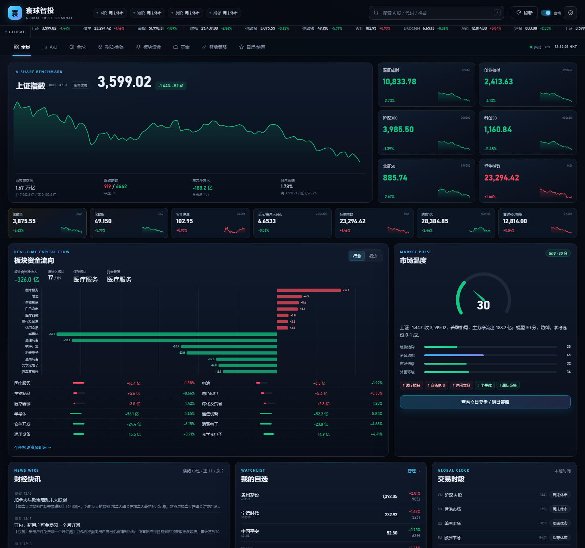
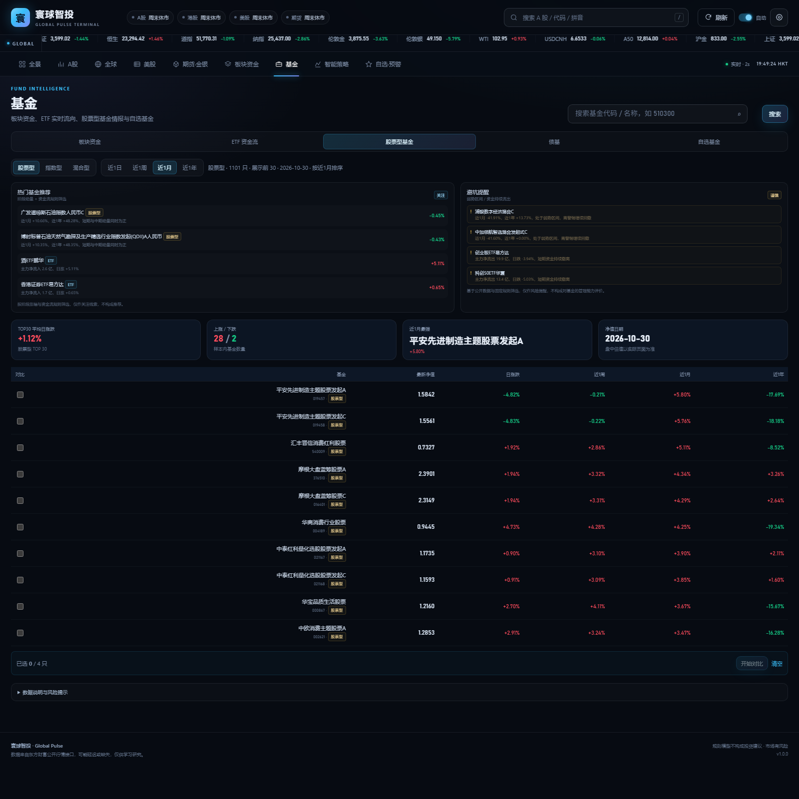
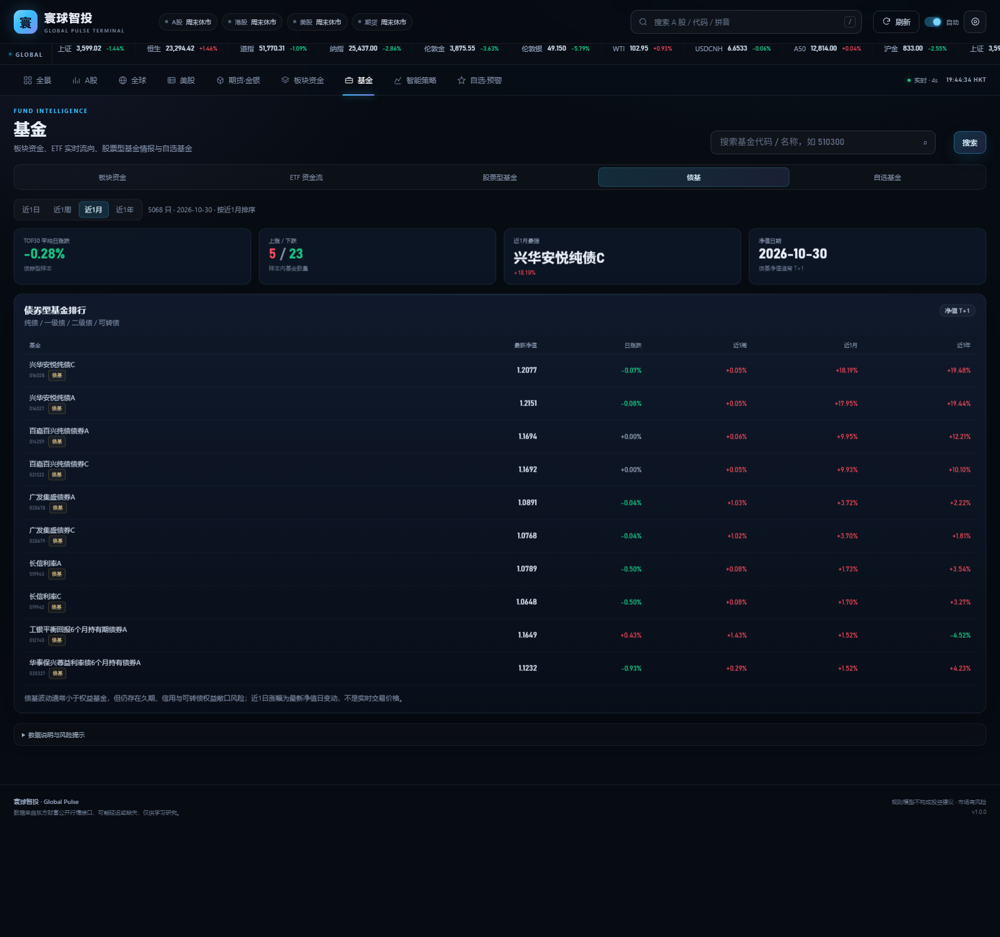
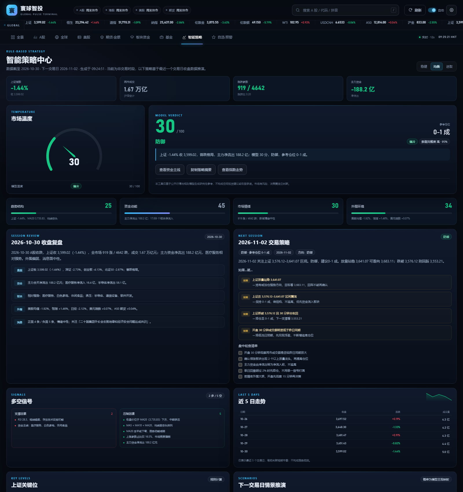
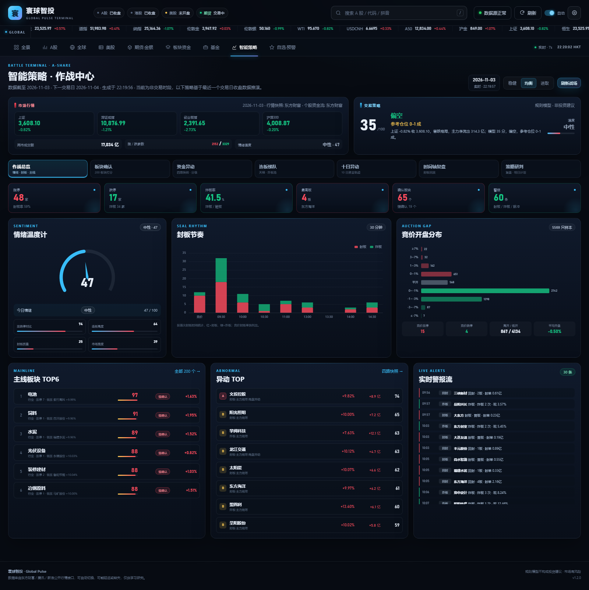

# 寰球智投 · Global Pulse Terminal

一个本地运行的「类同花顺」全市场行情与策略终端：A 股、美股专题、全球主要指数、全球期货、黄金白银、板块资金流向、财经快讯，以及基于规则模型的「今日复盘 / 下一交易日策略」。

> 数据来自公开行情接口，仅供学习研究，不构成投资建议。市场有风险，决策需独立判断。

## 系统简介

**寰球智投（Global Pulse Terminal）** 是一个自托管的个人行情与投资策略终端：前端是浏览器打开的单页应用，后端是零依赖的 Node.js 单进程服务，数据来自公开行情接口（东方财富 / 腾讯 / 新浪），自带账号体系与微信推送。

### 能力

| 模块 | 内容 |
|---|---|
| 行情 | A 股、美股（含盘前/盘中/盘后）、全球主要指数、全球期货、黄金白银、外汇 |
| 板块 | 行业/概念板块资金流向（今日 / 近 3 日 / 近 5 日 / 近 2 周 / 近 1 月） |
| 基金 | 自选基金、持仓、官方净值、穿透估算、基金排行与画像 |
| 策略 | 规则模型输出「今日复盘 / 下一交易日策略」、仓位建议、板块确认评分 |
| 账号 | 多账号注册登录，自选股票 / 自选基金 / 持仓按账号隔离，跨设备同步 |
| 推送 | 14:30 持仓策略、19:30 当日基金净值估值，支持 Server酱 / PushPlus / 企业微信 / 自定义 webhook |
| 外网 | Cloudflare 隧道 + 自有域名，电脑关机也能访问（部署在 7×24 常开的 NAS 上） |

### 技术特征

- **零 npm 依赖**：只用 Node.js 内置模块 + 一个 ECharts 前端文件
- **单文件后端**：`server.js`（约 9000 行），按能力拆分到 `lib/`
- **纯前端渲染**：无框架，`public/js/app.js` 状态机 + ECharts
- **数据落盘**：`data/*.json`，无数据库

## 操作概要

### 访问入口

| 场景 | 地址 |
|---|---|
| 外网 | `https://gp.ufomhb.xyz` |
| NAS 局域网 | `http://192.168.31.175:8090` |
| 本机开发 | `http://127.0.0.1:8090` |

首次打开会跳转登录页。**第一个注册的账号是主账号**，自动继承推送配置里的持仓，并继续使用微信推送；后续账号的自选与持仓互相隔离。

后台管理入口：`/admin.html`（管理员 / 超级管理员登录）。系统状态、用户权限、登录记录、每日流量与使用统计、微信推送、数据源、手机访问都已从终端设置移到后台；2026-11-17 起又新增两个板块：**部署到 NAS**（本机验证通过后一键推送代码，带 10 步进度）与**持仓策略**（按天记录加减仓建议、次日用净值验对错、按命中率自动调参）；2026-11-20 起再把持仓删除历史与两端互通独立成**持仓数据**板块。

### 运行方式

```bash
# 本机开发
npm start                                       # 或 node server.js --open
node server.js --port=8091 --host=127.0.0.1     # 换端口 / 只监听本机

# NAS（systemd）
systemctl status gp-terminal gp-tunnel           # 网页服务 / 隧道
systemctl restart gp-terminal                    # 改完代码后重启
```

### 与账号相关的接口

| 接口 | 作用 |
|---|---|
| `POST /api/auth/register` | 注册 |
| `POST /api/auth/login` | 登录（下发 30 天会话 Cookie） |
| `POST /api/auth/logout` | 退出 |
| `GET /api/auth/me` | 当前账号 |
| `POST /api/auth/password` | 修改密码（校验原密码，成功后旧会话全部失效） |
| `GET/POST /api/portfolio` | 自选股票 + 自选基金 + 持仓（按账号隔离） |
| `GET /api/admin/overview` | 后台概览（今日汇总、在线、最近登录） |
| `GET /api/admin/users` | 用户列表（角色、最近登录、今日/7 日使用） |
| `GET /api/admin/stats` | 每日流量与使用统计（按天 × 用户） |
| `GET /api/admin/logins` | 登录 / 改密 / 强制下线记录 |
| `GET /api/admin/system` | 服务、定时任务、磁盘、备份与统计存储 |
| `GET /api/admin/logs` | 后台读日志：末尾 N 行 + 关键词过滤（文件只接受白名单 id） |
| `POST /api/activity/ping` | 终端使用心跳（页面访问与在线时长） |

### 超级管理员

超级管理员（`role=super`）可以进入 `/admin.html`，管理所有普通用户与管理员的角色、重置密码、强制下线，并查看登录记录与使用统计。账号不写死在代码里，用脚本创建或重置：

```bash
node scripts/superadmin.js --user=superadmin   # 创建/重置，密码随机生成并打印
node scripts/superadmin.js --list              # 查看所有账号与角色
node scripts/superadmin.js --user=superadmin --password='自定义密码'
```

> 脚本只写入 `data/users.json` 的 scrypt 哈希，不保存明文；请把打印出来的密码另行保存。`data/users.json` 已在 `.gitignore` 中，不会随仓库发布。

### 数据与备份

运行数据有两种后端，由环境变量 `STORE` 决定（默认 `json`）：

| `STORE` | 存放位置 | 说明 |
| --- | --- | --- |
| `json`（默认） | `data/users.json`、`sessions.json`、`userdata/<id>.json`、`push-config.json`、`stats.json` | 旧行为，改造前一直用的方式，随时可回退 |
| `sqlite`（线上） | `data/gp.sqlite` | 事务写入，防并发丢写与崩溃损坏；账号 / 会话 / 自选 / 持仓 / 推送配置 / 统计全在库里 |

无论哪种后端，以下内容都不进数据库（可再生或内容类）：

- `data/boards.json` 板块清单、`data/sector-members.json` 板块成分、`data/us-sessions.json` 美股延时快照、`data/auction-YYYYMMDD.json` 竞价快照（自动保留最近 30 天）、`data/source-config.json` 数据源选择、`data/changelog.json` 更新履历。
- 行情数据只做内存 + 文件缓存，不进库。

**迁移与备份命令**（Node ≥ 22.5，`node:sqlite` 内置）：

```bash
node scripts/migrate-json-to-sqlite.mjs --dry-run   # 预演：只统计不写库
node scripts/migrate-json-to-sqlite.mjs --verify    # 正式导入并逐项比对
node scripts/backup-sqlite.mjs [输出路径]            # VACUUM INTO 一致性快照
STORE=sqlite node server.js                          # 用数据库启动
node server.js                                       # 去掉 STORE 即回退到 JSON
```

- **源 JSON 文件在迁移过程中只读**，所以回退只需去掉 `STORE=sqlite` 重启；代价是回退会丢掉切换之后写进库的新改动（真要回退，先 `node scripts/migrate-json-to-sqlite.mjs --dry-run` 看一眼再决定，或直接用迁移前的 tar 备份恢复）。
- 以上数据文件均已加入 `.gitignore`，不会进入仓库（含推送密钥与密码哈希）。
- NAS 上每天 03:30 自动备份到 `/data/backup/gp-data/`：`gp-YYYYMMDD.sqlite`（库快照）+ `data-YYYYMMDD.tar.gz`（其余文件，已排除库文件），各保留 7 份。
- 自测：`node scripts/selfcheck-p0.mjs`（安全基线 39 项）、`node scripts/selfcheck-store.mjs`（存储层 23 项，含迁移校验、并发登录、重启保持、回退）。

#### 数据库版本化迁移（schema v2，2026-11-17）

库结构不再靠「改代码 + 手工 ALTER」，而是纳入版本管理：

```bash
node scripts/migrate.mjs --status          # 看当前版本 / 待执行迁移 / 结构漂移
node scripts/migrate.mjs                   # 执行迁移（幂等，已最新则什么都不做）
node scripts/migrate.mjs --db=/tmp/x.sqlite # 对指定库操作（演练 / 排查）
node scripts/check-schema.mjs              # 只核对结构：缺表/缺列 → 退出码 1
```

- 版本号存在 SQLite 的 `PRAGMA user_version` 里，迁移条目在 `lib/store.js` 的 `MIGRATIONS` 数组；`SCHEMA_VERSION` 是代码期望的版本。
- **服务启动时自动迁移**（`openDb()` → `migrateOnOpen()`）；每条迁移在独立事务里执行，成功才写版本号，失败整条回滚并抛出，服务**不会带着旧结构启动**（避免 `no such column` 静默 500）。
- 老库（`user_version=0`）只有在结构与 `SCHEMA` 完全一致时才「认领」为当前版本，有缺则保持 0，让结构核对继续报错，不被版本号掩盖。
- 改结构的标准动作（三处必须同一次提交）：`SCHEMA` 里加新表/新列（让全新安装正确）+ `MIGRATIONS` 追加一条带 `version` 的迁移（让老库跟上）+ 递增 `SCHEMA_VERSION`；测试 `test/store-migrations.test.mjs` 会拦住「只加迁移忘了改 SCHEMA」的疏漏。
- 当前 v2 新增两张表：`strategy_records`（持仓策略按天记录，`payload` 存整条 JSON）、`strategy_meta`（规则参数 / 评价口径 / 调参历史 / 自动调参开关）。

### 日志与排障

服务端把 `console` 输出同时写文件，后台「系统日志」菜单直接读这些文件，不用再登 NAS：

| 位置 | 内容 |
| --- | --- |
| `logs/server.log` | 当前日志（启动信息、每个请求一行、`console.error`） |
| `logs/server.log.1~3` | 按大小轮转的历史（单文件 5 MB 上限，共保留 3 份） |
| `data/crash.log` | 未捕获异常 / 未处理 Promise 拒绝 / 收到 SIGHUP 的记录（进程没打印就退出的情况） |

- 后台入口：`/admin.html` → **系统日志**。可选文件、行数（100–1000）、关键词过滤，勾「每 5 秒刷新」可当实时尾随；日志用 `textContent` 渲染，不会把日志里的内容当 HTML 执行。
- 接口：`GET /api/admin/logs?file=server&lines=200&q=error`（管理员）。`file` 只接受内部白名单 id（`server` / `server.1~3` / `crash`），传路径不会越权读文件。
- 可调环境变量：`LOG_TO_FILE=0` 关闭落盘；`LOG_DIR` 改目录（默认 `logs/`）；`LOG_MAX_BYTES` 改单文件上限（默认 5242880）；`LOG_KEEP` 改保留份数（默认 3）。
- 落盘失败（磁盘满 / 只读挂载）不会影响服务：连续失败 3 次后自动摘掉文件写入，只在 stderr 提示一次。
- NAS 上除了这个菜单，也可以用 `journalctl -u gp-terminal -n 200 --no-pager` 看同样的输出（stdout 由 systemd 收集）。


### 部署拓扑（当前线上）

```
Cloudflare（gp.ufomhb.xyz）
   │ 隧道 gp
   ▼
小米 NAS（192.168.31.175，RP05，固件 1.0.9.462）
   ├─ gp-terminal.service   Node 24.22（/data/node24）· :8090
   ├─ gp-tunnel.service     cloudflared
   ├─ gp-root-shell.service 2323（IP 白名单）
   ├─ dockerctl.service     Docker 控制台 :9302
   ├─ gp-plugin-keep.timer  插件自愈（每 2 分钟）
   └─ gp-data-backup.timer  每日备份
```

NAS 上的部署方式（**没有 git，靠 scp 同步代码**）：

- **推荐：后台 `/admin.html` → 「部署到 NAS」→ 点「推送到 NAS」**（仅超级管理员，需二次确认）。流程固定 10 步并显示进度：检查本机工具与 NAS 连通性 → 打包代码 → 备份 NAS 现有代码 → **备份数据库快照**（`VACUUM INTO`）→ 上传 → 解压覆盖 `/data/gp` → **执行数据库迁移** → 重启 `gp-terminal` → **核对数据库结构** → 健康检查与版本核对。
  - 迁移特意排在重启**之前**：失败时线上进程仍跑旧代码，会自动 `tar` 回滚文件，站点不受影响（数据库有快照可回退）。
  - 只同步代码（`server.js` / `package.json` / `src` / `lib` / `public` / `scripts` / `data/changelog.json`），不动 NAS 上的 `data/` 运行时数据。
  - 等价命令行：`node tools/deploy-nas.mjs`（与按钮共用同一套引擎 `src/lib/nas-deploy.js`）；`--dry` 只预检不推送。`tools/` 整个目录在 `.gitignore` 里，部署 CLI 需 `git add -f` 才会进库。
- 代码目录 `/data/gp`（`server.js` / `lib` / `src` / `public` / `scripts` / `package.json` / `data`），systemd 单元 `/etc/systemd/system/gp-terminal.service`。
- **`src/` 必须一起同步**：`server.js` 会 `require('./src/lib/*')`，只 copy server.js 会导致起不来。
- Node 运行时：`/data/node24`（v24.22.3，2026-11-15 从 v20 升级，为 P1 的 `node:sqlite` 做准备）；旧的 `/data/node`（v20.19.4）保留，回滚时把单元里的 `PATH` 与 `ExecStart` 改回 `/data/node/bin/node` 即可。
- 手工升级流程：备份 `/data/gp` → scp 覆盖代码 → `systemctl restart gp-terminal` → `curl -s localhost:8090/api/health` 验证。
- 备份：`/data/backup/gp-code/`（代码，按次）、`/data/backup/gp-data/`（每日 03:30 快照，保留 7 天）与每次推送前的 `gp-before-<版本>-<时间>.sqlite` 库快照。

> 仓库只保存代码与文档；账号、密钥、隧道凭证均在本地，不入库。

### 安全基线（P0，2026-11-15）

服务端已默认启用：安全响应头（CSP 先 `Report-Only`）、`nosniff`、`X-Frame-Options: DENY`、`Referrer-Policy`、`Permissions-Policy`、HTTPS 下的 HSTS；会话 Cookie 在 HTTPS 下带 `Secure`，`data/sessions.json` 只存 `sha256(token)`；POST 校验同源 `Origin`；关闭开放注册；登录限流按「IP + 用户名」；webhook 只允许 `https` 且拒绝内网地址；JSON 落盘改为「临时文件 + rename」原子写。

| 环境变量 | 默认 | 作用 |
| --- | --- | --- |
| `ALLOW_REGISTER` | `0` | 是否允许注册新账号。空库时第一个账号始终可注册；之后要给同事开账号，可临时设 `1`，或用邀请码 |
| `INVITE_CODE` | 空 | 设置后注册必须带 `invite` 字段（登录页注册表单不显示此字段，走邀请码时用接口或先临时打开注册） |
| `TRUST_PROXY` | 空 | **部署在 Cloudflare 隧道 / 反向代理后必须设置**：`cloudflare`（读 `CF-Connecting-IP`）或 `1`（读 `X-Forwarded-For` 首段）。不设置时一律用直连地址，转发头会被忽略（防伪造） |
| `CSP_ENFORCE` | `0` | 先以 `Report-Only` 观察控制台违规；确认无误后设 `1` 强制执行 |

NAS 上的 systemd 单元建议加一行：

```ini
Environment=TRUST_PROXY=cloudflare
```

> 升级到本版本后，旧会话全部失效（令牌改存哈希），删除 `data/sessions.json` 可立即清空，重新登录一次即可。

### 测试与结构（P2，2026-11-15）

```bash
npm install                               # 只装测试依赖 jsdom（运行时仍然零依赖）
npm test                                  # 单元 + 集成 + DOM + 路由表 + 日志 + 策略 + 部署 + 指标 + 数据中心 + 基金分析/多组合/持仓删除历史（302 项，起隔离实例，不碰 data/）
npm run selfcheck                         # 安全基线 39 项 + 存储层 23 项
```

- 测试在 `test/`：`fund-analytics`（基金分档/连涨天数/主题等权指数/榜单排序）、`portfolio-groups`（多份持仓组合 CRUD、隔离、建仓日、快照恢复）、`holding-trash`（删除留档 / 按原值恢复 / 已重新持有跳过 / 删组合留档，JSON 与 SQLite 双跑）、`auth`（注册/登录/改密/会话失效）、`portfolio`（清洗、跨账号隔离、sqlite 模式）、`security`（安全头、同源校验、穿越、SSRF、后台权限、日志脱敏）、`logs`（轮转、末尾读取、关键词过滤、`/api/admin/logs` 鉴权与路径白名单）、`unit-security`（`src/lib/*` 纯函数）、`unit-push`（时段判断/幂等/配置归一）、`indicators`（KDJ/BOLL 公式与边界）、`datacenter`（席位归一化、上海时区日期、新股/转债申购与席位明细字段口径）、`routes`（解析源码里所有 /api 端点，逐个确认分发器认得）、`dom-smoke`（jsdom 载入真实 index.html，驱动快讯/榜单/基金页/策略页/预警/K 线控件/叠层弹窗的渲染函数）。
- 测试脚手架 `test/helpers/app.mjs` 会把代码复制到临时目录、用随机端口起一个实例，所以**不会改动仓库里的 `data/`**。
- 服务端纯逻辑在 `src/lib/`（`security.js` / `net-safety.js` / `log-files.js`），推送子系统在 `src/services/push.js`，HTTP 路由分发在 `src/http/routes.js`（三组：`handleAuth` / `handleAdmin` / `handleApi`，依赖由 `createHttpRoutes(deps)` 注入）。
- 前端已拆出 `public/js/util.js`（格式化/转义）、`public/js/dom.js`（选择器 `$` / `$$`、`toast`、`debounce`）、`public/js/api.js`（`api` / `apiPost` / 401 跳登录）、`public/js/core.js`（版本号、存储键、账号命名空间、预警 v2 结构、本地存储、全局 `state`），以及两个视图模块 `public/js/views/funds.js`（基金页渲染）与 `public/js/views/market.js`（全景页行情渲染 + 只读行情索引）。`app.js` 从 7,285 行降到 **6,828 行**，剩余视图（策略 / 自选 / 板块 / 美股等）按同一模式继续拆。视图模块的边界约定：**只做 state → DOM 的纯渲染**，取数（`load*`）与交互仍留在 `app.js`。
- 前端渲染约定：**外部文本进 `innerHTML` 前必须 `esc()`；进 `href`/`src` 前必须再过 `safeUrl()`**（`esc` 挡不住 `javascript:` 协议）。2026-11-15 审计了 225 处模板插值，35 处文本型全部安全，并补了 `safeUrl` 覆盖快讯链接等 2 处 href。
- CI：`.github/workflows/test.yml` 在 push / PR 时跑语法检查 + `npm test` + 两个 selfcheck。

### v2.10.5 更新（2026-11-22）

> 按用户要求重做持仓删除记录：**只记录被删的那个 TAB**，后台「持仓删除历史」看详情 + 按原状态恢复（保留建仓日）。**只在本机 8090 验证，未推 NAS。**

- **只记录被删的 TAB**：在「我的持仓 · 收益与结构」里删除一个 TAB（例如 TEST 只有 1 只基金）时，后台只记这条 TAB 的数据——TAB 名称 + 该 TAB 的基金名称 / 代码 / 份额 / 成本 / 建仓日，不再混入其它 TAB，也不再和整份账号快照混在一起。
- **后台改为「持仓删除历史」**：原来按每次保存列快照的「持仓保存历史」换成删除历史，只列删除记录：删除时间 / TAB 名称 / 删除类型（整个 TAB / 单只基金）/ 基金数 / 状态（待恢复 / 已恢复）。
- **详情**：每条记录可展开「详情」，看被删 TAB 的信息：本次删除的基金明细（名称 / 代码 / 份额 / 成本 / 建仓日）；删的是整个 TAB 时还会列出删除时该 TAB 下的全部持仓。
- **恢复**：按删除前的状态写回——TAB 已删除的按原名称重建（重名加后缀），份额 / 成本 / **建仓日原样恢复**；已有持仓的基金跳过，不覆盖后来的操作。
- **口径**：恢复后盈亏统计仍从原建仓日开始，不会把加入持仓之前的历史净值自动算进来；老记录没有建仓日的按恢复时刻算（宁可不统计，也不提前）。
- **自动对账**：用户后来自己把基金加回来（手动补录 / 从服务端恢复 / 快照回滚）时，删除记录自动标成「已恢复」；v2.10.4 及以前留下的逐条删除记录，第一次打开时自动补成 TAB 事件，可直接查看 / 恢复。
- **接口**：新增 `GET /api/admin/portfolio/deletions?userId=&pending=1`、`POST /api/admin/portfolio/deletions/restore`（管理员）；旧的 `/api/admin/portfolio/trash*` 接口保留兼容。
- **测试**：新增 `test/deletion-history.test.mjs` 8 项（JSON + SQLite：只记录被删的 TAB、详情数据、按原名称重建并保留建仓日、单只删除只补缺、手动加回自动标记已恢复、旧记录自动补成事件、同名 TAB 并入不重建）；`dom-smoke` 后台卡片断言同步更新。`npm test` 302 项全绿。

### v2.10.4 更新（2026-11-22）

> 基金页四处调整：板块总览 TAB 前移、表头点击排序、连跌天数用负数；修复场外基金对比计数；后台回收站记录「删除时的 TAB 快照」并支持整组恢复。**只在本机 8090 验证，未推 NAS。**

- **TAB 顺序**：基金页子页改为「板块总览 → 板块资金 → 基金涨跌分布 → 场外基金 → …」（板块总览移到板块资金前面；默认打开子页仍是板块资金）。
- **板块总览表头排序**：点「当日涨跌 / 连涨天数 / 近5日 / 近1月」按该列降序，再点同一列切换升序；表头显示 ▲/▼，当前排序列高亮，顶部快捷排序同步高亮并新增「按近5日」。缺数据的主题无论升降序都排最后（`sortFundThemes()` 纯函数，可单测）。
- **连涨 / 连跌天数**：原「连涨天数」列改名「连涨/连跌天数」并改为带符号显示，正数（`3 天`）= 连续上涨，负数（`-2 天`）= 连续下跌，悬停写明口径；主题详情抽屉显示「连涨 / 连跌天数」。服务端新增 `themeStreakSigned()`（旧 `themeStreakFromSeries()` 语义不变）。
- **修复场外基金对比计数**：勾选「对比」后「已选」停在 0/4、按钮点不动——`toggleCompareFund()` 只刷新了股票型基金页的对比条。现在两条对比条一起刷新并同步勾选；超过 4 只时还原多勾的那一个。
- **后台回收站记录更完整**：删除持仓时额外保存「删除那一刻该 TAB（组合）下的全部持仓快照」（基金名称 / 代码 / 份额 / 成本 / 建仓日），后台可展开查看；新增「恢复整个 TAB」——原组合还在就合并写回，原组合已删除就按原名称重建（重名加后缀）再写回；已持有的基金跳过不覆盖，同一 TAB 的相关删除记录一起标记为已恢复。接口 `POST /api/admin/portfolio/trash/restore-tab`。
- **后台说明**：「持仓保存历史」改名「持仓保存历史（快照）」，并注明它保存的是每次保存的整份快照；要看删除记录请用下面的「持仓回收站（已删除的持仓与组合）」。
- **测试**：`fund-analytics` +2（带符号连涨连跌、主题总览连跌为负）、`holding-trash` +4（JSON/SQLite：单只删除后 TAB 快照仍含全组并可整组恢复；整组删除后按快照重建同名组合）、`dom-smoke` +2（表头排序与连跌负数、场外基金对比计数同步）。`npm test` 294 项全绿。

### v2.10.3 更新（2026-11-22）

> 自选基金页三处按用户要求调整：持仓表改用「当日涨跌 / 当日估值」、新增「持仓调整」批量改份额、删除持仓可在后台回收站恢复。**只在本机 8090 验证，未推 NAS。**

- **我的持仓改用「当日涨跌 / 当日估值」两列**：原表格里的「今日盈亏」整列换成与「我的自选基金」同口径的两列——「当日涨跌」是真实净值涨跌幅（今日净值未出时回退最近一期并标明净值日），「当日估值」是 15:00 冻结的预估涨跌幅（可与真实涨跌对比看估值准不准），并新增「操作」列（改 / 删）。今日盈亏仍然保留在面板顶部的 KPI 卡和「今日盈亏 TOP5」里，只是不再作为明细列重复展示。
- **新增「持仓调整」**：放在组合 TAB 右侧「新建 / 重命名 / 删除」旁边。一个弹窗里列出当前组合的每只持仓（份额、成本预填），也列出「自选里还没持有」的基金（份额留空、可直接补录）；改完点「保存全部」一次性提交，避免逐只点「仓」。份额填 0 = 清仓。
- **删除持仓可恢复**：删除仍然是写 `shares=0` 的墓碑（多端合并不会把删掉的数据带回来），同时服务端在每次写入的 before/after 对比里认出被删掉的条目，把**删除前的份额、成本净值、建仓日和所在组合**存进 `user_extras['fund_holding_trash']`（留档 365 天 / 每账号最多 500 条）。逐条删除、持仓调整里删除、删掉整份组合、恢复到旧快照这几种路径都会自动留档，前端不需要额外请求。
- **后台「持仓数据 → 持仓回收站」**：按账号查看待恢复条目（删除时间 / 基金 / 组合 / 份额 / 成本 / 建仓日 / 状态），点「恢复」按原值写回原组合；如果该基金现在已有新持仓，保留现有数据并跳过（不覆盖用户后来的操作）；原组合已被删除的恢复到「主持仓」。可勾选「含已恢复」查看历史。
- **接口**：新增 `GET /api/admin/portfolio/trash?userId=&all=1`、`POST /api/admin/portfolio/trash/restore`（管理员）；持仓删除的留档在 `POST /api/portfolio`、`POST /api/portfolio/groups`、快照恢复、本机 ⇄ NAS 拉取的写入链路里统一发生。
- **测试**：新增 `test/holding-trash.test.mjs`（JSON / SQLite 各 3 项：删除留档原值、后台按原值恢复、已重新持有则跳过、删组合一并留档并回到主持仓；另 1 项权限：未登录 401 / 普通用户 403 / 缺 userId 400）；`dom-smoke` 增至 71 项（持仓表两列与改删按钮、持仓调整弹窗内容、批量保存与删除写墓碑、后台回收站卡片）。`npm test` 286 项全绿。

### v2.10.2 更新（2026-11-22）

> 布局微调：自选基金页把「我的持仓 · 收益与结构」移到「今日盈亏 TOP5」上面。**只改前端布局 + 版本号，本机 8090 验证，未推 NAS。**

- 自选基金页从上到下的顺序改为：组合 TAB → **我的持仓 · 收益与结构** → 今日盈亏 TOP5 → 盈亏日历 → 我的组合 vs 上证 → 盈亏统计 → 我的自选基金。TOP5 是按当前组合的持仓算出来的，先看持仓结构再看榜单更顺。
- 测试：dom-smoke 增加「我的持仓面板必须排在 TOP5 之前」的布局断言，67 项全绿。

### v2.10.1 更新（2026-11-22）

> 两处小修：场外基金对比勾选框点不动、盈亏日历空数据写成「休」。**只动前端 + 版本号，本机 8090 验证，未推 NAS。**

- **修复：场外基金勾选对比会被当成打开详情**。表格自己的 click 监听虽然跳过了勾选框，事件仍会冒泡到全局行点击委托（按 `data-fund-code` / `data-stock-fund-code` 打开详情），于是勾选框一点就弹窗。现在全局委托先忽略 `[data-compare-code]`，并且不再接管 `#fundBoardTable` 内的行（该表有自己的点击处理），勾选只触发 `change` → 加入/移出对比。
- **修复：盈亏日历没有数据时显示「休」**。日视图里非交易日 / 净值未出 / 建仓前的格子统一显示 `--`（周末本来就不占列），不再让人误解为休市。
- **测试**：dom-smoke 增加「没有数据的交易日必须显示 `--`、日历里不得出现『休』字」断言，66 项保持全绿。

### v2.10.0 更新（2026-11-22）

> 按用户反馈重做基金页：默认隐藏 5 个参考性不强的模块（后台可随时打开），新增「板块总览 / 基金涨跌分布 / 场外基金」与统一「基金比较」；自选基金补上多份持仓组合、建仓日、盈亏日历、今日 TOP5 与「组合 vs 上证」对比。**schema 升到 v5（自动迁移），只在本机 8090 验证，未推 NAS。**

- **基金页显隐可控**：后台新增「界面管理」，9 个子页逐个勾选；默认隐藏「场外资金流 / 每日代理 / ETF 资金流 / 股票型基金 / 债基」（只隐藏不删代码）。配置写 `data/ui-config.json`（`GET /api/ui/config` 公开读、`POST /api/admin/ui/config` 管理员写），前端启动时读一次；被隐藏子页的 `?fundview=` 深链自动回退到第一个可见子页。
- **基金涨跌分布**：上涨/下跌/平盘家数 + 11 档柱状图 + 上涨占比 + 净值日。样本可切「权益类场外基金（股票+指数+混合）」或「ETF」；净值日取样本众数日期（QDII 滞后不会把整列带偏）。（接口 `GET /api/funds/distribution?scope=equity|etf`）
- **板块总览（基金主题口径）**：按当日涨跌 / 连涨天数 / 近1月排序，列出涨跌幅、连涨天数、近5日、近1月、涨跌家数、基金数、代表 ETF。点开抽屉看代表 ETF 当日分时（周末回退最近交易日）、主题等权历史走势（起点 100）、主题内 ETF 与场外基金。连涨天数 = 代表 ETF 等权日涨跌连续为正的天数；没有行情时显示 `--` 而不是 0。（接口 `GET /api/funds/themes`、`GET /api/funds/theme?sector=`）
- **场外基金四个榜**：涨幅 / 跌幅 / 热门 / ETF，展示名称、当日涨幅、近1周/1月/1年、关联板块（`classifyFundSector` 按名称关键词归类），支持类型筛选、勾选对比，点行看详情（含前十大重仓与近 8 季持仓变动）。**热门榜没有官方人气数据**，用「近1周 50% + 近1月 30% + 当日 20%」做热度代理，并剔除同一基金的不同份额、同主题最多 2 只，页面写明是代理口径。（接口 `GET /api/funds/board?tab=gain|loss|hot|etf`）
- **基金比较统一入口**：基金页顶部「基金比较」可搜索选 2~4 只（ETF 与场外可混选），场外基金表也能勾选；对比弹窗输出指标表 + 近半年归一化走势图（`/api/funds/compare` 额外返回 `history`）。
- **「头部沪深300基金 / 流通市值」移回 A 股页**（v2.4.0 曾迁入基金页，本次按用户要求迁回），A 股视图与刷新链路同步调整。
- **多份持仓组合**：自选基金页顶部 TAB 切换，可新建 / 重命名 / 删除（主持仓不可删，最多 12 份），组合之间持仓互不影响；组合列表与持仓都走服务端同步（`POST /api/portfolio/groups`，`GET/POST /api/portfolio` 新增 `portfolios` 字段），换设备自动恢复；后台「持仓数据」快照记录组合数并可整体回滚。主持仓仍存 `portfolio_holdings`（v2.9.2 的合并/墓碑/审计链路不变），额外组合存 `user_extras` 的 `fund_portfolios` 键。
- **建仓日（addedAt）**：schema **v5** 给 `portfolio_holdings` 加 `added_at`（自动迁移）。每条持仓可填/改「建仓日期」；盈亏统计、日历、TOP5、组合对比一律从建仓日起算，不再统计建仓之前的数据。旧持仓迁移时按最近一次保存时间作为建仓日（保守口径，绝不含建仓前数据），可在持仓编辑器里改成真实日期。
- **盈亏日历**：日视图是「周一到周五 × 1~31 日」的日历格（周末不占列），月视图 12 个格子，年视图按年；可切「金额 / 收益率」（收益率 = 区间盈亏 ÷ 区间起点市值），支持上/下月、上/下年翻页。
- **今日盈亏 TOP5**：盈利 / 亏损两个 TAB，默认显示盈利；**一笔盈利都没有时自动落到亏损 TAB**。列出基金、今日盈亏、当日涨跌幅、持有市值与仓位占比，点行看详情。
- **我的组合 vs 上证指数**：当日 / 本周 / 本月 / 今年 / 全部五档，同一张双线图 + 「我的收益率 / 上证涨跌 / 超额收益（跑赢或跑输 X 个百分点）」KPI。当日为盘中估算曲线（ETF/联接按目标 ETF 分时、重仓型按前十大重仓分时加权，QDII 与未披露持仓按 0% 平线并列出覆盖率，`GET /api/funds/intraday-series`）；日线档用「逐日盈亏率链式复合」，中途加仓不会把本金算成收益。
- **口径**：日/月/年盈亏 = 份额 × 当日净值变动后逐日累加；月度/年度按逐日盈亏求和；今日盈亏仍沿用「9:00 前前日净值 / 盘中按当日估值 / 15:00 冻结 / 今日净值公布后按今日净值」四段口径；不含申赎费，份额按当前录入值静态加权；场外净值 T+1、QDII 更滞后。
- **接口**：新增 `GET /api/funds/distribution`、`/api/funds/themes`、`/api/funds/theme`、`/api/funds/board`、`/api/funds/intraday-series`、`/api/ui/config`、`POST /api/admin/ui/config`、`POST /api/portfolio/groups`；`/api/portfolio` 的 GET/POST 新增 `portfolios`；`/api/funds/pnl-series` 的 `days` 上限放宽到 800 并返回上证指数日线；`/api/funds/compare` 返回近半年归一化走势。
- **测试**：新增 `test/fund-analytics.test.mjs`（分档边界、连涨天数、等权指数、榜单排序/去重/热度、工厂注入假数据）16 项、`test/portfolio-groups.test.mjs`（json + sqlite：组合 CRUD、隔离、建仓日不被覆盖、上限、快照恢复）12 项、`store-migrations` v5 2 项；`dom-smoke` 增至 66 项（界面显隐、逐日盈亏裁剪、日历网格、TOP5 默认 TAB、组合 vs 上证、切换组合、新子页渲染与转义）。

### v2.9.3 更新（2026-11-20）

> 只动后台信息架构：把「持仓保存历史」「持仓数据互通」从「模拟交易」页移到新菜单。接口、脚本、数据结构都没变。**只在本地 8090 验证，未推 NAS。**

- **后台新增「持仓数据」菜单**，位置在「持仓策略」与「模拟交易」之间。这两张卡操作的是持仓存储本身（`data/portfolio-writes.jsonl`、`data/portfolio-history/`、`scripts/portfolio-{export,import}.mjs`），与模拟盘账户、排行榜无关；当初是随模拟盘改造（v2.9.0）顺手挂在「模拟交易」页底部的，不是按功能分类放的。
- **顺手修掉**：进「持仓数据」页时「数据互通」卡的账号下拉是空的（此前要等点「本机 → NAS」才填充），现在切页即填好。
- **测试**：`dom-smoke` 58 项全过；后台 HTML 用 jsdom 断言「14 个菜单 ↔ 14 个 section 一一对应、无重复 id、两张卡只在新页」。`npm test` 因本会话沙箱限制（子进程 `spawn EPERM`）不能整包跑，改为单文件直跑。

### v2.9.2 更新（2026-11-20）

> 主题是「持仓不再回滚」：本机与线上是两套 `data/`，以前在一边改的持仓另一边看不到、同步失败还没提示。本版把服务端变成唯一真源 + 审计快照 + 两端互通，并顺手修掉开盘前价格 0、基金盈亏口径看不清、模拟盘金额不动这几件事。**只在本地 8090 验证，未推 NAS。**

- **修复：持仓「昨天改了今天回滚」**。实测证据：11-19 之后本机 `logs/server.log` 里没有任何 `/api/portfolio` 写入，`data/push-config.json` 与 `data/userdata/<主账号>.json` 的 mtime 停在 11-17 01:28，而线上 `gp.ufomhb.xyz` 一直是 2.9.1 正常服务 → 说明改动写进了线上（NAS）那一套数据。三层根因：① 部署只同步代码、**不动线上 `data/`**，两边各记一套；② 前端 `syncPushWatchlist` 用 `catch {}` 静默吞错；③ 启动时只在「本机压根没有该账号数据」才拉服务端。现在每次启动都对齐服务端，本机未同步改动按条目时间戳合并后上推，失败时面板显示「本机已保存 · 未同步（点击重试）」并自动重试 3 次。
- **新增：持仓写入审计与历史快照**。`data/portfolio-writes.jsonl`（时间/账号/IP/条数/变更摘要）+ `data/portfolio-history/<账号>/<rev>.json`（每账号 20 份）。后台「模拟交易」页可查保存历史并一键恢复。
- **新增：条目级合并 + 删除墓碑**。多设备/多标签页同时改不再互相覆盖；删除写 `shares=0` 墓碑（SQLite schema **v4** 加 `portfolio_holdings.removed_at`，部署时自动迁移）；自选基金/自选股用 `baseRev` 做冲突检测（过期提交返回 `conflict` + 服务器快照，前端对齐后重试一次）。
- **新增：本机 ⇄ NAS 持仓数据互通**。后台按钮走现有 SSH 私钥与 `scripts/portfolio-{export,import}.mjs`，单向推送/拉取（merge / replace），前后留备份与快照，账号 ID 不一致直接中止。
- **修复：开盘前价格 0 / 模拟盘全亏**。行情统一出口（`fetchQuoteList`）新增价格归一：无成交价但有昨收 → 现价=昨收、涨跌幅 0、标 `prevClose`，前端显示「昨收」；都没有才置空。模拟盘按昨收估值、开盘前禁止模拟成交；基金估值跳过「昨收顶替」的报价。
- **改进：基金「今日盈亏」口径可视化**。两面板统一叫法，常驻标签「按前日净值 / 按当日估值 14:32 / 按 15:00 估值终值 / 按今日净值」+ 时间点说明；`/api/funds/watch` 新增 `phase`。
- **修复：模拟盘顶部金额盘中不动**。15 秒刷新纳入 `/api/paper`；累计盈亏拆成「持仓浮盈 + 已实现」，显示更新时刻；排行榜缓存 30s→15s 并显示截至时刻；三处金额共用同一套计算。
- **文案**：登录页去掉「每天登录会被记录在后台」；排行榜保留「N 个账号」、去掉「另有 N 个账号被管理员隐藏」。
- **测试**：新增 `test/quotes-fallback.test.mjs`（价格归一四态 + 互通导入导出）、扩展 `portfolio.test.mjs`（合并/墓碑/冲突/审计恢复/sqlite）与 `dom-smoke`（口径标签、榜单文案、模拟盘 KPI），全套保持通过。

### v2.7.0 更新（2026-11-19）

> 修掉「点一下就没了」的三个交互坑，把自选列表统一成同一套表格，并补上打新与席位这两块复盘数据。**本版同时部署到本机 8090 与 NAS（/data/gp）。**

- **修复：个股详情被二级抽屉顶掉**。根因是「基本面 / 龙虎榜」「个股资讯」都走 `mountOverlay`，直接替换 `#overlayRoot` 的 `innerHTML`，把个股弹窗销毁了。新增叠层机制 `pushOverlay` / `topLayer`（`.overlay-layer`，z-index 高于基座）：上层只盖在上面，关闭时只摘掉自己；`closeOverlay()` 优先弹最上层，空栈后才清 hash 与 `state.stockModal`。抽屉内部的选择器同步改成作用域查询（`overlay.querySelector('.drawer')`）。
- **修复：查看大盘策略会顺带关掉个股详情**。改为 `data-strategy-new` → 新标签页打开 `#strategy`，本页个股详情保持不动；被浏览器拦截时退回原行为（关弹窗 + 本页切策略）。
- **改版：我的自选列表 = 自选基金同款表格**。复用 `.fund-watch-table`（表头、拖拽手柄、`t-name/t-code`、K/警/× 操作按钮、手机端列精简全继承），只加 `watch-stock-table` 做自选股专属微调；拖拽排序抽成 `bindWatchDrag`（桌面 HTML5 + 手机长按），与自选基金共用 `bindTouchReorder`。
- **信息层级：模拟交易面板上移**到「我的自选」之前，账户状态与自选操作同屏。
- **新增：新股申购日历**（数据中心 → 财经日历 → 新股申购）。东财 `RPTA_APP_IPOAPPLY`，按申购日升序列出今日及以后：申购代码、发行价（未定价显示「待定」）、申购上限、发行市盈率、行业 PE、中签号日、上市日。日期按**上海时区**取「今天」（`todayText()`），避免 `toISOString()` 在凌晨把今天算成昨天而漏掉当天。
- **新增：转债申购日历**（同页 → 转债申购）。与可转债看板同源（`RPT_BOND_CB_LIST`），按网上申购日 `PUBLIC_START_DATE` 过滤：申购代码、正股、评级、发行规模、转股价、上市日。
- **新增：龙虎榜机构席位明细**。个股「基本面 / 龙虎榜」里按上榜日分组展开席位（席位名 / 买入 / 卖出 / 净额），机构席位与沪深股通打标签并汇总「机构净额」；买入侧与卖出侧两张报表按「日期 + 席位」合并，多上榜原因按日期合并，0 成交的分类席位剔除。新接口 `GET /api/longhu/seats?code=&limit=`。
- **口径**：主板披露到营业部（「机构专用」即机构），科创板/创业板有时只披露「机构 / 中小投资者 / 其他自然人 / 沪深股通」分类，页面上明确标注；新股未定价绝不拿预测价冒充发行价。
- **测试**：183 项全绿（新增 `test/datacenter.test.mjs` 9 项：席位归一化、时区日期、两条日历与席位明细的字段口径；dom-smoke 增至 45 项：叠层关一层保住下层、自选表结构、新股/转债日历渲染、席位区块分组）。

### v2.6.0 更新（2026-11-19）

> 把「盯盘」「复盘」「看消息」三件事补齐：预警能离开页面、交易能记账复盘、个股能看相关新闻。**仍只部署本机 8090。**

- **云端预警（2.4）**：预警规则可同步到服务端（schema v3 新增 `user_extras`），关掉页面/关机后仍按 60 秒评估，命中走已有推送通道；命中一次即置已触发，量比与均线类每轮最多拉 8 只 K 线。
- **模拟交易（3.3）**：自选页新增账户面板，初始 100 万，按最新价成交，佣金万 2.5（最低 5 元）+ 卖出印花税万 5；A 股强制 100 股整数倍，资金/持仓不足明确拒绝。
- **信号留痕（3.3）**：每笔成交把当时的大盘评分与评级一起记入 `trades`，复盘能看到「这笔是在什么信号下做的」。
- **个股资讯（3.6）**：个股详情新增「个股资讯」，抽屉列出东财全站搜索的相关新闻，标题与链接经转义 + `safeUrl` 过滤。
- **修复**：业务校验错误（股数非法、资金不足、持仓不足、缺代码）此前被映射成 502，现在正确返回 400 并带原因。
- **测试**：170 项全绿（新增 `test/alert-paper.test.mjs` 11 项，dom-smoke 增至 41 项）。
- **手机端核查**：用隔离实例 + Edge 无头按 390×844 逐页截图验收，9 个一级页面与详情弹窗均正常；修掉 6 处移动端问题（云端预警开关被全局隐藏、龙虎榜重复行与列溢出、上榜原因被截断、选股表单标签折行、日历/转债/选股表溢出）。18 张证据图在 `docs/screenshots/mobile/`，详见路线图「手机端核查」一节。

### v2.5.0 更新（2026-11-19）

> 客户端阶段 2/3：补上「研究复盘」这一层数据（龙虎榜、日历、转债、选股、F10），把港股和美股个股也做成可下钻的详情。**同样只发布到本机 8090，未推送 NAS。**

- **修复 A 股个股弹窗偏小**：新增 `.modal-stock` 专用版面（最宽 1520px、主图 460px、盘口改三列），1180 / 980 两档响应式回退，K 线工具条与右侧评分卡不再互相压字。
- **美股个股详情**：点美股热度表任意一行或 TOP12 卡片即可打开，用 CNBC 1 分钟成交画 04:00–20:00 整日分时（带时间轴、昨收基准、开盘/收盘分界），支持整日/盘前/盘中/盘后切换并列出三段快照；`#/us/AAPL` 可分享。
- **数据中心（新一级导航）**：龙虎榜（按交易日、净额、上榜原因）、财经日历（限售解禁只看今天及以后 / 分红送转）、可转债（东财名单 + 腾讯现价合并）、条件选股。
- **条件选股器**：基于新浪全市场快照（约 5500 只）扫描后按涨跌幅/换手/成交额/市值/PE/PB/价格/板块过滤，结果缓存 10 分钟。**东财 clist 在本机被拒**，所以没有沿用东财口径。
- **港股热门 + 港股个股**：全球页新增 10 只港股报价（腾讯 gtimg，按 GBK 解码），点开有分时与日 K（前复权），`#/hk/00700` 可分享。
- **基本面抽屉（F10）**：个股详情新增「基本面 / 龙虎榜」按钮，含公司概况、主要财务、股东研究、分红融资、该股上榜历史。
- **PWA**：manifest + icon + **网络优先、仅离线兜底**的 Service Worker——发版后刷新即拿到新版本（规避历史发版缓存陷阱），`/api` 不缓存。
- **修复**：`fqt` 缺省被 `Number(null)=0` 误判成显式不复权，港股 K 线因此拼出空复权标记报 502；选股结果北交所 secid 前缀错写（现按 sh→1 / sz→0 / bj→2）。
- **测试**：`npm test` 157 项全绿；dom-smoke 增至 39 项（新增美股分时、A 股弹窗、数据中心四子页）。

### v2.4.0 更新（2026-11-18）

> 客户端第一阶段：把「看盘」和「盯盘」两块补上专业终端的基础能力，并把详情页做成可分享的地址。**本版只发布到本机 8090，暂未推送到 NAS。**

- **K 线副图指标**：新增 MACD / KDJ / BOLL / 关闭 四档切换，A 股主图、全球、美股、期货金银、个股详情、场内基金 K 线共用同一设置并记住选择。后端 `lib/indicators.js` 新增 `KDJ(9,3,3)` 与 `BOLL(20,2)`，随 `/api/kline` 的 `series` 一起下发；BOLL 是主图叠加通道，MACD 与 KDJ 各占独立副图，数据不足时自动降级为无副图而不报错。
- **K 线复权切换**：`/api/kline`、`/api/stock` 新增 `fqt`（0 不复权 / 1 前复权 / 2 后复权），缓存 key 带 fqt 维度。A 股日线在「不复权」下走原有搜狐 / 新浪链路（并主动跳过返回前复权价的腾讯长周期接口，口径不再被悄悄改掉）；「前复权 / 后复权」按 **东方财富 → 腾讯 `web.ifzq.gtimg.cn` 的 qfq/hfq → 未复权降级** 三级回退（实测本项目网络下东财 kline 返回 `rc:102`，由腾讯复权兜底，茅台同日收盘价：不复权 1433.33 / 前复权 1381.35 / 后复权 9577.23）。指数与期货按 `fqtApplicable=false` 标注「该标的无复权概念」，只有真正取不到复权序列时才提示「数据源暂无复权序列，仅为不复权价」。`/api/kline` 新增 `fqt`、`fqtApplied`、`fqtApplicable` 三个字段供前端判断。
- **详情页路由化**：个股、板块、基金详情升级为 `#/stock/<secid>`、`#/sector/<code>`、`#/fund/<code>`，可复制、收藏、新标签直接打开；后退键正常关闭弹窗 → 关闭时地址栏退回视图级 hash。旧的 `#dashboard` 视图路由与 `?stock=` / `?sector=` / `?fund=` 深链保持兼容。
- **条件预警升级**：从「价格突破/跌破」扩为五类——价格、涨跌幅、量比（当日成交量 ÷ 前 5 日均量）、均线上穿/下穿 MA20、MACD 金叉/死叉。旧 `{type,price}` 结构在加载时自动迁移为 v2，不丢数据；触发时记录时间、触发价与说明，列表区分「监控中 / 已触发」。判定抽成纯函数 `evalAlertRule`，价格与涨跌幅只看快照，量比与趋势类才拉 K 线（180 秒缓存），并有并发保护避免重复触发。
- **信息架构**：A 股页「头部沪深300基金 / 流通市值」迁入基金页「板块资金」子页；板块资金页与基金板块资金子页互相加跳转入口，明确「全市场板块资金」与「ETF 口径」是同一批资金的两种看法。
- **前端拆分**：全景页行情渲染（行情索引、跑马灯、指数网格、资产条、板块资金、市场温度、快讯、自选、交易时段）抽成 `public/js/views/market.js`，`app.js` 从 7,153 行降到 **6,828 行**。这是视图拆分的第二轮（第一轮是 `views/funds.js`），剩余视图按同一模式继续拆。
- **文档**：新增 `docs/客户端改进路线图.md`（现状盘点、对标东财/同花顺的缺口矩阵、阶段 1~4 分期方案与实施状态）。
- **测试**：新增 `test/indicators.test.mjs`（9 项，锁死 KDJ 初值与递推、BOLL 对称性、预热期 null 语义）与 11 项 DOM 用例（指标/复权控件、路由解析、五类预警规则、迁移与面板渲染、入口归并）；`npm test` 从 128 项增至 **148 项**。

### v2.2.0 更新（2026-11-17）

> 这一版把「改代码 → 上线」和「持仓策略 → 复盘」两件事都做成可操作的闭环。

- **后台「部署到 NAS」**：本机验证通过后一键推送代码，10 步进度（检查连通性 / 打包 / 备份代码 / **备份库快照** / 上传 / 解压 / **执行迁移** / 重启 / **核对结构** / 健康检查）。仅超级管理员、需二次确认、同时只允许一个任务；迁移排在重启前，失败自动回滚代码。
- **数据库版本化迁移（schema v2）**：用 `PRAGMA user_version` + `MIGRATIONS` 增量迁移，服务启动时自动升级；每条迁移独立事务、失败整条回滚；新增 `scripts/migrate.mjs`（`--status` / `--db=`）与 `scripts/check-schema.mjs`（缺表缺列退出码 1，多余历史列只告警）。
- **后台「持仓策略」页**：每天 14:35 自动记录当天「加仓/减仓/不变」建议（与 14:30 推送同一套分组规则，收盘后才补记会标 `late`）；次日用**已公布净值**（盘中估算不算）判定前一天建议是否合理；展示总体/分动作/分评分区间的命中率。
- **全自动调参**：样本 ≥ 5 且命中率 < 50% 时自动调整评分门槛（加仓命中差 → `addScore` +5，减仓命中差 → `cutScore` −5），每次调参，只动这两个参数、每天最多一次、命中率达标时不自动放宽；每次改写都留痕（前后值/命中率/样本数），页面可一键回滚。规则参数在页面可调，保存后推送与记录立即生效。
- **持仓策略入库**：记录从 JSON 文件迁到 SQLite（`strategy_records` / `strategy_meta`），JSON 模式仍回落 `data/strategy-log.json`；SQLite 首次读到空表会自动导入旧 JSON，切库不丢历史。
- **测试**：新增 deploy / schema / store-migrations / strategy-log / strategy-api 共 7 个用例文件；并修复测试脚手架并行运行时**随机端口撞车**导致的偶发失败（改为先探测空闲端口）。

### v2.0.1 更新（2026-11-15）

- **后台「系统日志」**：新增菜单，可选日志文件（当前 / 轮转 / `crash.log`）、行数 100–1000、关键词过滤，支持每 5 秒自动刷新与一键复制；错误行标红、警告行标黄。
- **日志落盘**：`console` 输出同时写 `logs/server.log`，按 5 MB 轮转保留 3 份；写失败只提示一次、不影响服务（`LOG_TO_FILE=0` 可关闭）。
- **目录整理**：仓库根目录不再散落资源——19 张预览图移入 `docs/screenshots/`（其中 3 张过期版本移到 `archive/`），运行日志统一进 `logs/`（已 gitignore，只保留 `.gitkeep`）。

### v2.0 更新（2026-11-15）

> 这一版以「安全 + 存储 + 结构」为主，功能界面基本不变。

- **安全加固（P0）**：安全响应头（CSP 先 Report-Only）、Cookie 仅 HTTPS 带 `Secure`、会话只存 `sha256` 哈希、注册默认关闭、登录限流按「IP + 用户名」、POST 同源校验、webhook 禁内网、静态目录穿越加固、5xx 脱敏、日志敏感参数打码。
- **存储改造（P1）**：账号 / 会话 / 自选 / 持仓 / 推送配置 / 使用统计迁到 **SQLite**（`data/gp.sqlite`），事务写入；行情快照仍走文件缓存并按天清理；`STORE=json` 可一键回退；备份改为 `VACUUM INTO` 快照 + 数据打包。
- **结构重构（P2）**：服务端外移 `src/lib/security.js`、`src/lib/net-safety.js`、`src/services/push.js`、`src/http/routes.js`（`server.js` 9,166 → 7,541 行）；前端外移 `util.js` / `dom.js` / `api.js` / `core.js` / `views/funds.js`（`app.js` 7,285 → 6,756 行）。
- **测试体系**：新增 53 项自动化测试（HTTP 集成、纯函数、DOM 渲染、路由表）+ 两个隔离自检脚本，接入 GitHub Actions。
- **行为变化**：升级后旧会话全部失效，需要重新登录一次；
- **运维**：NAS 运行时升级到 Node 24（`/data/node24`），与本地开发版对齐。

### v1.5 更新（2026-11-15）

- **后台管理独立**：新增 `/admin.html`，系统状态、用户与权限、登录记录、每日流量/使用统计、微信推送、数据源、手机访问、更新履历全部迁入；终端设置只保留个人偏好（刷新 / 风险 / 通知 / 导出 / 重置 / 账号）。
- **超级管理员**：新增 `super` 角色，可授予/收回管理员，可重置任意账号密码、强制下线；账号由 `scripts/superadmin.js` 创建，不写死在代码里。
- **登录与使用统计**：记录每次登录/失败/改密/重置/强制下线（时间、IP、设备），按天统计每个账号的请求数、传输字节、使用时长与页面访问分布。
- **手机端**：顶栏重排为两行网格，不再横向溢出；主导航吸顶固定并支持横向滑动；极窄屏只保留刷新 / 账号 / 退出 / 设置。
- **PC 顶栏**：状态标签允许换行、按钮在窄屏只留图标，A股 / 港股 / 美股 / 期货四个开市状态完整显示。
- **修改密码**：登录页新增「修改密码」标签页；终端设置内也可修改，成功后所有旧会话失效。

### v1.3 更新

- **A 股**：默认打开当天分时图，价格线 + 均价线 + 昨收基准 + 分钟成交量，自动刷新时实时跟随。
- **全球**：新增恒生科技指数（`124.HSTECH`）；全球指数逐行显示未开盘 / 交易中 / 已收盘 / 休市与当地时间。
- **美股**：24H 热门美股 TOP10 实时分时卡片，可切换盘前 / 盘中 / 盘后；热门股补充所属板块与细分行业；新增美股板块资金（12 个板块的成交额、加权涨跌、涨跌家数、资金流估算）。
- **板块资金**：新增今日 / 近3日 / 近5日 / 近2周 / 近1月 五个周期，热门板块 TOP10 随周期联动；流入/流出 TOP10 支持「本期 vs 上期（今日 vs 昨日）」对比图。














---

## 1. 快速启动

### 方式 A：双击启动（Windows）

双击 **`启动.bat`**。脚本会先检查本地服务是否已运行：已运行则直接打开浏览器，未运行则启动服务并自动打开：

```
http://127.0.0.1:8090
```

关闭黑色命令行窗口即停止服务。

### 方式 B：命令行

```bash
# Node.js 18+
node server.js --open

# 或
npm start

# 只启动服务，不自动开浏览器
npm run serve

# 换端口
node server.js --port=8091
```

无需安装任何 npm 依赖，也不需要构建步骤。

---

## 2. 功能地图

| 模块 | 内容 |
| --- | --- |
| **全景** | 上证主图、5 大 A 股指数、7 类全球资产快照、板块资金流（流入降序；流出先取最多 7 个板块，再按流出绝对额升序）、市场温度、情绪着色财经快讯、自选、全球交易时段 |
| **A 股** | 默认打开「今日分时」并随行情自动刷新（价格线 + 均价线 + 昨收基准 + 分钟成交量），也可切换日 K / 周 K / 月 K / 60 分 K，日 K 支持近 10 年；**副图指标可切 MACD / KDJ / BOLL / 关闭，复权可切不复权 / 前复权 / 后复权**；上证/深证/创业板/沪深300/科创50 五张独立走势卡片（各自坐标）；MA5/10/20/60、成交量、市场宽度、沪深涨跌分布、涨幅/跌幅/主力流入/流出榜（「头部沪深300基金占比」已迁到基金页） |
| **美股** | 纳斯达克/纳指100/标普500/道指可点击切换；**24H 热门美股 TOP12 实时分时**（可切换盘前 / 盘中 / 盘后，美东 04:00–20:00 真实分钟成交）；**点任意热门股打开个股详情**（整日分时 + 时间轴 + 昨收基准 + 三段快照，`#/us/AAPL` 可分享）；每只热门股带所属板块与细分行业；**美股板块资金**（12 个板块的成交额、加权涨跌幅、涨跌家数、资金流估算）；24H 最热美股前 100 只（按成交额，两列各 50 只），每只展示盘前 / 盘中 / 盘后三段价格与涨跌幅；全美涨跌分布 |
| **全球** | 亚太、欧洲、美洲 19 个主要指数（含**恒生科技指数**），逐行显示**未开盘 / 交易中 / 已收盘 / 休市**与当地市场时间；恒指/美股/纳指 K 线，汇率与美元指数，跨市场温度；**港股热门 10 只**（腾讯行情），点开可看分时与日 K |
| **期货·金银** | 伦敦金、伦敦银、上海金、COMEX 金银铜、NYMEX 原油/铂金、布伦特、天然气、A50 期货、国内主连；金银比与 USD/oz → CNY/g 换算器 |
| **板块资金** | **多周期热门板块**：今日 / 近3日 / 近5日 / 近2周 / 近1月 五个窗口的板块资金排行；资金热力图、流入/流出 TOP10（流入降序；流出先取最多 10 个板块，再按流出绝对额升序）、**本期 vs 上期（今日 vs 昨日）对比图**、热门板块 TOP10（含近 6 日主力净额 sparkline）、可搜索排序明细 |
| **基金** | 默认显示四个子页：**板块总览（基金主题，点表头按当日涨跌 / 连涨天数 / 近5日 / 近1月升降序；连涨天数正数 = 连涨、负数 = 连跌）、板块资金、基金涨跌分布、场外基金（涨幅/跌幅/热门/ETF 四个榜）**；「场外资金流 / 每日代理 / ETF 资金流 / 股票型基金 / 债基」默认隐藏、可在后台「界面管理」打开。板块资金与一级「板块资金」互相跳转；场外基金展示关联板块、盘中估值、基金经理、规模、风险、前十大重仓股与近 8 个季度持仓变动；顶部「基金比较」支持 ETF 与场外混选（指标表 + 近半年归一化走势）；热门基金与避坑提醒、债基排行保留在隐藏子页 |
| **智能策略** | **作战中心**：作战总览（涨停/跌停/炸板率/最高板/确认板块/警报 6 KPI、情绪温度计、封板节奏 30 分钟直方图、竞价开盘分布、主线板块 TOP6、异动 TOP、实时警报流）、板块确认（行业+概念 200 个板块按涨幅/主力净流入/上涨家数/涨停数打 0–100 分，输出强确认/已确认/观察中/待确认，展开成分股、一键监控、通达信 .blk 导出）、资金异动（主力净流/涨速/涨幅/净流出四路快照，计算增量主力、流入加速、价格脉冲、量比、距涨停、封板/炸板、尾盘异动并分级）、连板梯队（最高板→首板分列，封单/首封/一字/炸板/涨停统计，炸板池、跌停池）、十日异动（10 日累计涨幅、连涨/连跌、涨停次数、最大单日、量能放大、资金连续流入、sparkline，涨/跌双向）、时间轴复盘（真实封板/炸板时间生成 120 个事件，30×–300× 回放）；原今日复盘、明日策略、三情景、关键位、组合建议保留在「策略研判」子页 |
| **自选·预警** | **模拟交易账户**（初始 100 万、按最新价成交、含费用、成交记录带当日大盘评分做信号留痕）排在自选列表之前；**云端预警**开关（规则存服务端，关页面也监控，命中走推送）；自选股与自选基金分开展示，**两者是同一套表格样式**（拖拽手柄、K/警/× 操作、手机端同样精简列），支持拖动整行或 ↑↓ 手动排序，自选基金另可按日涨跌/名称排序；**自选基金支持多份持仓组合（TAB 切换、服务端同步、带建仓日）、盈亏日历（日/月/年，金额或收益率）、今日盈亏 TOP5/亏损 TOP5、组合 vs 上证（当日/本周/本月/今年/全部）**；自选基金与自选股同口径展示主力净流入、技术评分、评级/仓位（场外基金按净值序列计算）；自选股评分、支撑压力、参考仓位；**条件预警五类**（价格 / 涨跌幅 / 量比 / 均线穿越 MA20 / MACD 金叉死叉），触发后记录时间、触发价与说明并区分「监控中 / 已触发」；浏览器通知；本地持久化；JSON 导出 |
| **数据中心** | 龙虎榜（按交易日、上榜净额、买入/卖出、成交占比、上榜原因，点行看个股）、财经日历（限售解禁只看今天及以后、分红送转、**新股申购、转债申购**）、可转债（东财名单 + 腾讯现价，剔除退市债与 NQ 品种）、条件选股（新浪全市场快照约 5500 只，支持涨跌幅/换手/成交额/市值/PE/PB/价格/板块过滤）；个股「基本面 / 龙虎榜」含**机构与席位明细**（按上榜日分组，机构/股通打标并汇总机构净额） |

### 交互细节

- 顶部搜索支持股票代码、名称、拼音；快捷键 `/` 聚焦搜索。
- K 线可叠加 **MACD / KDJ / BOLL** 副图或关闭（默认 MACD）。BOLL 画在主图通道上，MACD 与 KDJ 各占独立副图；指标选择与复权口径都保存在设置里，切页、刷新、切换周期都保持。
- **复权口径**可切「不复权 / 前复权 / 后复权」。不复权走搜狐 / 新浪链路（口径一致）；前复权与后复权依次尝试东方财富与腾讯的复权接口，取到的是真正的复权价（茅台同日收盘价：不复权 1433.33 / 前复权 1381.35 / 后复权 9577.23）。指数与期货没有复权概念，会明确标注「该标的无复权概念」；只有确实取不到复权序列时才提示「数据源暂无复权序列，仅为不复权价」，不会把未复权价冒充复权价。
- **详情可分享**：个股 `#/stock/1.600519`、板块 `#/sector/BK0475`、基金 `#/fund/510300` 可直接复制给他人或收藏；后退键会关闭弹窗，地址栏自动退回视图 hash。
- A 股 K 线支持 **分时 / 日K / 周K / 月K / 60分**；分时只显示最近交易日 09:30–15:00，日K 可回溯近 10 年。
- A 股页**默认进入「分时」**：价格线 + 均价线 + 昨收虚线，右轴显示相对昨收的涨跌幅，底部是分钟成交量；自动刷新开启时每 15 秒跟随行情更新（服务端 12 秒缓存，浏览器端 8 秒缓存）。
- 点击日K/周K/月K上的某个交易日，会异步加载该日分时。最近 5 个交易日为 1 分钟；更早日期自动回退到 5/15/30/60 分钟；超过约 1 年则展示当日日线摘要（开高低收、成交额、收盘位置），不再报错。弹窗内分时图带时间横轴与价格纵轴。
- 「五大指数」改为五张独立卡片：上证、深证、创业板、沪深300、科创50 各自使用独立纵坐标，避免科创50等高波动指数压缩其他指数；点击卡片可切换上方主图。
- A股页的「头部沪深300基金 / 流通市值」用近半年曲线展示头部 10 只纯沪深300 ETF 规模合计占沪深300流通市值的比例，并列出规模靠前的基金。
- K 线底部滑块可缩放范围；自动刷新时会保留当前缩放区间，不会跳回默认视图。
- 点击任意指数卡片、全球指数行、个股行、板块行，都会打开对应详情。
- 「美股」专题以纳斯达克为主图，点击纳指/纳指100/标普500/道指卡片可切换对应指数；24H 最热美股前 100 只分两列展示，每列 50 只。
- 24H 最热美股每行给出**盘前 / 盘中 / 盘后**三段数据：盘前 04:00–09:30、盘后 16:00–20:00（美东）展示最近一次延时交易时段的价格与涨跌幅，盘中为最近正式交易日；正在进行的时段表头带高亮圆点，单元格 tooltip 标出数据时间。
- **24H 热门美股 TOP10 · 实时分时**按成交额取前 10 只，每张卡片画出该股当天的分时曲线；右上角 **盘前 / 盘中 / 盘后** 可切换，默认跟随美东当前时段。分时来自 CNBC 的 1 分钟成交价，覆盖 04:00–20:00 的全部延时交易时段，没有成交的时段显示「该时段暂无成交」；服务端缓存 2 分钟。
- 热门股所属板块与细分行业来自纳斯达克全市场快照（NASDAQ + NYSE + AMEX）。**美股板块资金**把全美个股按 12 个板块汇总：成交额、成交额加权涨跌幅、涨跌家数、资金流估算 = Σ(成交额 × 涨跌幅)。这是方向性估算，不是交易所披露的真实净流入。
- A 股和美股都提供 11 档涨跌分布柱状图：>10%、7~10%、5~7%、3~5%、0~3%、平盘，以及对称的跌幅区间。
- 财经快讯按情绪着色：偏多用红色边框、偏空用绿色边框、中性用灰色边框。
- 美股热度用最近交易日成交额作为关注度代理，不含 ETF、ETN 和杠杆产品；盘前 / 盘后取自新浪美股与 CNBC 的延时快照，首次启动时用 Nasdaq 补齐最近一次盘后收盘，快照写入 `data/us-sessions.json`，重启后可继续回看当天的延时数据。
- 全球指数逐行显示交易状态：**未开盘 / 交易中 / 已收盘 / 休市 / 周末休市**，按各交易所当地时间（香港、东京、首尔、台北、悉尼、孟买、法兰克福、伦敦、巴黎、纽约、多伦多、圣保罗）实时判断，并给出当地时间。
- 板块资金页顶部可在 **今日 / 近3日 / 近5日 / 近2周 / 近1月** 之间切换，热门板块 TOP10、流入/流出 TOP10 与明细表随周期联动；「对比图」把流入、流出 TOP10 的本期与上一等长周期（今日对应昨日）并排画出。
- 多周期榜依赖东方财富板块资金接口：接口不可用时今日视图回退到新浪口径，其它周期给出明确提示与「重新加载」按钮；近1月在接口不提供 20 日榜时，用近2周活跃板块的每日主力净额逐日累加，并在页面上标注为样本内排行。
- 自选页把自选股和自选基金拆成两个独立面板；自选股、自选基金都支持拖动整行或 ↑↓ 手动排序；自选基金另可按日涨跌、名称排序。
- 「智能策略」拆成 **作战总览 / 板块确认 / 资金异动 / 连板梯队 / 十日异动 / 时间轴复盘 / 策略研判** 七个子页；页面顶部把“市场行情”（指数、成交额、涨跌家数、情绪温度）与“交易策略”（模型评分、评级、参考仓位、一句话结论）分成两块，避免行情与策略混在一起。
- **作战总览**的 6 张 KPI 分别对应涨停、跌停、炸板率、最高板、确认板块、警报；情绪温度计由涨跌停对比、连板高度、封板质量、市场宽度合成；封板节奏按首次封板时间每 30 分钟统计（午间休市不占档），竞价开盘分布按全市场开盘价相对昨收分 9 档。
- **板块确认**取成交额靠前的 89 个行业板块 + 111 个主题概念板块（剔除昨日涨停、新高、基金重仓等统计型板块），按涨幅 28%、主力净流入 32%、上涨家数 18%、涨停数 22% 的百分位加权成 0–100 分；≥78 强确认、≥62 已确认、≥45 观察中，其余待确认。概念板块的涨停数在成分接口不可用时用当日涨停股的 F10 所属板块反推，并在展开项中标注口径。
- 板块行支持展开成分股（东财成分股接口限流时先展示该板块当日涨停成员）、一键加入监测池（保存在浏览器 localStorage）、一键导出通达信 `.blk`（每行“市场前缀+代码”，1=沪市、0=深市、2=北交所）。
- **资金异动**把主力净流榜、涨速榜、涨幅榜、净流出榜四路快照合并去重；盘中每次刷新累积主力增量，计算 1 分钟增量、流入加速倍率、5 分钟价格脉冲、量比、距涨停、封板/炸板/跌停状态与尾盘异动，逐只打 A/B/C/D 级；支持按主力抢筹、急速拉升、放量突破、封板、炸板、尾盘异动筛选，点击行打开分时 + 主力分时与触发原因。
- **连板梯队**从最高板到首板分列，卡片展示封单额、首封时间、一字板、炸板次数、`N天M板` 统计；下方独立展示炸板池和跌停池。**十日异动**只扫描 10 个交易日（候选池为涨停/炸板/跌停 + 涨跌幅榜 + 资金异动），给出累计涨幅、连涨/连跌天数、涨停次数、最大单日、量能放大倍数、资金连续流入天数与 10 日 sparkline。**时间轴复盘**把首次封板、回封、炸板、跌停事件按真实时间排序并抽样到 120 个，支持 30×/60×/120×/300× 加速回放。
- 智能策略页的「自选组合建议」会把自选股票和自选基金一起纳入：按债券/货币、黄金/商品、海外、宽基、行业、混合分类，给出股票/权益基金/债券/黄金/现金的建议配置比例，并用环形饼图 + 图例展示；同时列出每只股票和基金的动作（加仓/持有/减仓/定投/对冲等）。
- 基金页默认四个子页：**板块总览 / 板块资金 / 基金涨跌分布 / 场外基金**；「场外资金流 / 每日代理 / ETF 资金流 / 股票型基金 / 债基」默认隐藏，后台「界面管理」可逐个打开（只隐藏不删代码，隐藏后的 `?fundview=` 深链会回退到第一个可见子页）。
- 基金涨跌分布按「上涨/下跌/平盘家数 + 11 档柱状图」展示，样本可切权益类场外基金或 ETF，并标出净值日；板块总览点表头按当日涨跌/连涨天数/近5日/近1月升降序（再点同一列切换方向，缺数据排最后，连跌用负数），点行看代表 ETF 当日分时与主题等权历史走势；场外基金四个榜（涨幅/跌幅/热门/ETF）带关联板块与对比勾选（勾选后「已选 N/4」与「开始对比」同步，两条对比条一致）。
- 自选基金顶部多份持仓组合 TAB 切换（主持仓 + 最多 11 份自建组合，互不影响）；每条持仓有「建仓日」，盈亏日历、今日 TOP5、组合 vs 上证都从建仓日起算；今日 TOP5 没有盈利时自动显示亏损 TAB。
- 「场外资金流」读取最新基金季报的期间申购 / 期间赎回，按（申购 − 赎回）× 期末单位净值估算净额，分别展示净流入、净流出 TOP50，支持按股票/混合/指数/债券/货币/商品类型筛选；季报口径，不是实时申赎数据。
- 「每日代理」用于弥补场外基金没有每日申赎数据的问题：把指数 / ETF 联接基金按名称主题匹配到目标 ETF，用「目标 ETF 最新交易日主力净流入 ×（场外基金最新季报规模 ÷ 目标 ETF 当前规模）」估算代理净额，并明确标注为代理口径；主动基金不参与，仍需看季报榜。
- 「板块资金」统计全部股票型、指数型、混合型场外基金（含 A/C 份额），与 ETF 资金流聚合；默认按净流入排序，可切换涨跌幅或近1月。
- 「股票型基金」保留基金排行、热门推荐、避坑提醒和 2–4 只基金对比；「债基」提供债券型基金按日/周/月/年排行。
- 股票型基金详情里可以查看盘中估值、基金经理、基金规模、风险等级、前十大重仓股及重仓股当日表现。
- 点击「板块资金」中的板块行，可查看该板块内 ETF 和股票基金明细；板块归类按名称主题近似划分。
- 勾选 2–4 只基金后点击「开始对比」，比较收益、回撤、夏普、规模、经理、费率与重仓重合度。
- 基金详情的「持仓变动历史」展示近 8 个季度的前三大重仓、新进/退出/增持/减持数量。
- 「热门基金推荐」和「避坑提醒」由阶段涨幅、资金流和弱势规则筛出，仅作线索，不构成推荐。
- 刷新频率可在右上角设置中调整为 10/15/30/60 秒，或关闭自动刷新。
- 风险偏好（稳健/均衡/进取）会改变策略的参考仓位区间。
- 价格预警只在本页面打开时监控；刷新页面后自动恢复。
- **条件预警**共五类规则：价格（突破/跌破）、涨跌幅（高于/低于）、量比（当日成交量 ÷ 前 5 日均量）、均线（上穿/下穿 MA20）、MACD（金叉/死叉）。价格与涨跌幅只看快照，量比与趋势类才拉 K 线；交叉类只在「穿越发生的那一根」触发，持续在上方不算新金叉。触发记录保存在本机，列表分「监控中 / 已触发」。
- 预警仍只在页面打开时运行（云端推送与后台常驻预警属于下一阶段）。
- 所有自选、基金自选、预警、设置保存在浏览器 `localStorage`，不上传服务器。

---

## 3. 策略模型说明

### 3.1 综合评分

策略分数为 0–100，由五部分加权：

| 维度 | 权重 | 说明 |
| --- | --- | --- |
| 趋势结构 | 42% | 上证/深证/创业板/沪深 300 的均线、MACD、RSI、量价、20 日高低位 |
| 市场宽度 | 20% | 全市场上涨/下跌家数、涨跌比 |
| 资金动能 | 18% | 全市场主力净流入、板块净流入家数 |
| 外围环境 | 12% | 美股三大指数、恒指、日经、DAX、美元指数 |
| 新闻情绪 | 8% | 财经快讯关键词的正负面打分 |

### 3.2 输出内容

- **今日复盘**：顶部关键指标卡（上证、成交额、涨跌家数、主力资金）+ 盘面/资金/板块/外围/消息五段式复盘；多空信号；近 5 日走势。
- **下一交易日策略**：方向、核心区间、强支撑/强压力、`如果…就…` 规则、盘中检查清单、放量突破/跌破后的应对、关注/回避板块、仓位建议。
- **三情景推演**：乐观 / 中性 / 谨慎，给出模型主观概率、触发条件、应对动作和目标位。
- **关键位**：可视化价格阶梯 + 枢轴点 S1/S2/R1/R2、MA20、20 日高/低。
- **数据完整度**：根据日线长度、板块覆盖、快讯数量、市场宽度、外围资产数量计算，不代表预测准确率。
- **风险清单**：外围、资金、普跌、模型局限等动态提示。

### 3.3 参考仓位

评分与仓位的映射（再按风险偏好 ±10%）：

| 评分 | 评级 | 参考仓位 |
| --- | --- | --- |
| ≥72 | 强势偏多 | 6–8 成 |
| 60–71 | 偏多 | 4–6 成 |
| 48–59 | 中性 | 2.5–4.5 成 |
| 36–47 | 偏空 | 1–2.5 成 |
| <36 | 防御 | 0–1 成 |

> 这是规则模型，不是 AI 预测，也不是个性化投顾。它只能帮助建立观察框架，不能替代你的判断。

### 3.4 作战中心评分口径

| 模块 | 口径 |
| --- | --- |
| 板块确认 | 涨幅 / 主力净流入 / 上涨家数占比 / 涨停数分别转成 0–100 百分位，按 28% / 32% / 18% / 22% 加权；≥78 强确认、62–77 已确认、45–61 观察中、<45 待确认 |
| 情绪温度 | 50 为中性；按涨跌停差、最高板、炸板率、市场宽度、上证涨跌逐项加减，限制在 0–100；≥78 炽热、62–77 偏暖、45–61 中性、32–44 偏冷、<32 冰点 |
| 资金异动分级 | 主力净流入规模、1 分钟增量、涨跌幅、量比、5 分钟脉冲、流入加速、封板/炸板状态、尾盘时段分别计分；A≥70、B≥50、C≥30、D<30 |
| 封板节奏 | 以涨停池 `首次封板时间` 统计封板家数，以炸板池 `首次封板时间` 统计炸板家数；09:30–11:30、13:00–15:00 每 30 分钟一档，竞价封板单独一档 |
| 竞价开盘分布 | 开盘价相对昨收的跳空幅度：≥7%、3~7%、1~3%、0~1%、平开、0~-1%、-1~-3%、-3~-7%、≤-7%；同时统计竞价涨停/跌停、高开/低开家数与平均开盘 |
| 十日异动 | 以最近 11 个交易日收盘价计算 10 日累计涨幅；涨停次数按板块涨跌停幅度判定（主板 10%、创业/科创 20%、北交所 30%、ST 5%）；量能放大 = 最近 5 日均量 ÷ 前 5 日均量；资金连续流入取新浪每日主力净流入 |
| 时间轴复盘 | 首次封板、回封、炸板、跌停事件按分钟排序，超过 120 个时按时间等距抽样并保留最后一个事件；回放速度 30×–300×，1 个交易日约 67 秒（300×）到 11 分钟（30×） |

> 板块确认、资金异动、连板梯队与时间轴都基于最近一个交易日的收盘数据；盘中打开页面会继续累积增量。所有分数都是规则映射，不构成投资建议。

---

## 4. 数据源与降级策略

行情能力被拆成「能力 × 数据源」两层：每个能力都可以单独指定首选源，失败时自动回退到其它源。默认「自动容错」顺序为 东方财富 → 腾讯 → 同花顺 → 新浪；连续失败的源会进入 90 秒冷却，冷却期内优先使用其它源。下表的「主数据源」是自动模式下的第一优先，失败后按「降级/补充」列回退。

### 4.1 数据源切换（v1.1）

- **设置入口**：右上角 ⚙ 设置 → 行情数据源。可选 自动容错 / 优先东方财富 / 优先腾讯 / 优先同花顺 / 优先新浪，也可对单项能力单独指定；勾选「不回退」只用首选源，便于排查。
- **状态提示**：顶栏「数据源」徽标、页面顶部横幅、设置面板内的状态点（绿=正常、灰=未检测、红=失败）。
- **配置文件**：`data/source-config.json`，服务端持久化，重启后保留。
- **接口**：`GET /api/source/status`、`POST /api/source/config`、`GET /api/source/probe?cap=quotes`。

| 能力 | 东方财富 | 腾讯 | 同花顺 | 新浪 | 回退后的变化 |
| --- | --- | --- | --- | --- | --- |
| 行情快照（指数/个股/ETF/港股/美股） | ✅ 最全 | ✅ 价格、成交额、市值、PE | ✅ A 股与主要指数，含涨跌家数 | ✅ 价格、成交额 | 主力净流入缺失；全球指数覆盖约 8/20 |
| 板块行情与资金 | ✅ 含超大/大/中/小单 | — | — | ✅ 净流入、涨跌幅 | 板块代码变为新浪口径，走势图与成分股不可用 |
| 板块走势 / 成分股 | ✅ | — | — | — | 仅东方财富 |
| 个股资金流分时 | ✅ 分时曲线 | — | — | ✅ 当日快照 | 只有当日资金结构，没有分时曲线 |
| ETF 资金流排行 | ✅ | — | — | — | 仅东方财富，不可用时页面显示说明 |
| 涨跌幅 / 成交额榜 | ✅ | — | — | ✅ | 一直优先走新浪 |
| 7×24 快讯 | ✅ | — | — | ✅ 滚动新闻 | 情绪统计样本略有差异 |
| K 线（日/周/月/分钟） | 内置 搜狐 → 腾讯 → 新浪 | 同左 | 同左 | 同左 | 不受切换影响 |
| 分时图 | 内置 腾讯 → 东财 → 新浪 | 同左 | 同左 | 同左 | 不受切换影响 |
| 基金净值 / 排行 / 季报 | ✅ 天天基金 | — | — | — | 无免费替代源 |

同花顺接入说明：

- 使用的是同花顺网页版行情接口 `d.10jqka.com.cn/v6/realhead/...`，无需登录、无需 `hexin-v` 令牌，返回 GBK 编码的 JSONP。
- 覆盖 A 股与上证、深证、创业板、沪深300、科创50 等主要指数；港股、美股、商品、外汇没有对应的免费接口，会自动跳过。
- 指数快照自带「总家数 / 上涨 / 下跌」，因此东方财富限流时，涨跌家数会改由同花顺补齐（沪市 + 深市口径，不含北交所）。
- 同花顺不提供公开的主力资金流、ETF 资金流、板块资金流接口（`data.10jqka.com.cn` 有反爬校验），这些能力仍依赖东方财富。

> ETF 资金流排行、场外基金净值、板块成分股只有东方财富（天天基金）提供，没有可切换的公开替代接口；不可用时页面会显示明确提示，不会整页报错。

| 数据 | 主数据源 | 降级/补充 |
| --- | --- | --- |
| A 股/全球/期货/外汇实时报价 | 东方财富 `push2` | 失败时返回缓存并标记「缓存」 |
| 美股实时报价 | 东方财富全球指数 `ulist` | 纳指、纳指100、标普500、道指 |
| 24H 最热美股 | 新浪财经美股列表 | 按最近交易日成交额排序，过滤 ETF/ETN/杠杆产品 |
| 美股盘前 / 盘后 | 新浪美股 `gb_` 批量快照 → CNBC 延时报价 | 新浪缺字段时由 CNBC 补；首次启动 / 重启后用 Nasdaq 延时页面补最近一次盘后收盘，结果缓存到 `data/us-sessions.json` |
| 美股涨跌分布 | Nasdaq Screener | NASDAQ + NYSE + AMEX 普通股 |
| A 股涨跌分布 | 新浪财经沪深 A 股列表 | 沪深样本，不含北交所 |
| 板块实时资金流 | 东方财富板块清单 + `ulist` 批量报价 | 板块清单缓存于 `data/boards.json` |
| 个股/板块资金榜 | 新浪财经资金流接口 | 东方财富失败时自动切换 |
| ETF 列表 | 新浪财经 `etf_hq_fund` | 按成交额取前 400 只 |
| ETF 实时报价/主力流 | 东方财富 `ulist` | 与新浪 ETF 列表合并 |
| 基金板块资金 | ETF 主力流 + 股票基金名称归类 | 板块内 ETF 净流入合计、平均涨跌、股票基金阶段表现 |
| 场外基金搜索 | 东方财富基金搜索 | 结果优先展示同名 ETF |
| 场外基金净值 | 东方财富基金净值接口 | 最新净值 + 最近 120 个交易日 |
| 场外基金资金流 | 天天基金规模变动 `FundDataPortfolio_Interface` | 最新季报期间申购/赎回，净额按期末净值估算，输出净流入/净流出 TOP50 |
| 场外基金每日代理 | 东方财富 ETF 最新交易日主力流 + 腾讯 ETF 规模 + 季报规模 | 目标 ETF 主力净流入 × 场外基金规模占比，仅作方向代理 |
| 股票型基金排行 | 天天基金 `rankhandler` | 股票型/指数型/混合型，按日/周/月/年排序 |
| 基金板块全样本 | 天天基金股票/指数/混合排行 | 三类型合并去重，统计全部场外权益基金 |
| 基金估值/档案/持仓 | 天天基金移动端接口 | 盘中估值、经理、规模、风险、前十大重仓股 |
| 基金阶段收益/对比 | 天天基金移动端 `FundMNPeriodIncrease` | 近1周/1月/3月/1年/2年/3年 |
| 基金历史持仓 | 天天基金 `FundArchivesDatas` | 近 8 个季度，自动计算新进/退出/增减持 |
| A 股指数/个股 K 线 | 搜狐财经（日/周/月，近10年）+ 新浪财经（分时/60分） | 日/周/月自动聚合，分时只保留最近交易日 |
| A 股历史分时 | 腾讯 `day/query`（1分钟，5日）→ 东方财富 `kline klt=5`（约1月）→ 新浪 `scale=5/15/30/60`（约1月/3月/6月/1年） | 按日期自动逐级回退；超过约1年返回日线摘要，不再报错 |
| 沪深300基金规模/流通市值 | 天天基金基金档案 + 东方财富指数 `f21` | 头部纯沪深300 ETF 规模合计 / 指数流通市值 |
| 债券型基金排行 | 天天基金 `rankhandler?ft=zq` | 纯债/一级债/二级债/可转债，按日/周/月/年排序 |
| 港股/美股 K 线 | 腾讯财经 | 恒指、道指、纳指、纳指 100、标普 500 |
| 全球期货/伦敦金银 K 线 | 新浪财经全球期货 | COMEX 金银铜、WTI、布伦特、伦敦金银、A50 |
| 财经快讯 | 东方财富 7×24 快讯 | — |
| 股票搜索 | 东方财富搜索建议 | — |
| 涨停 / 炸板 / 跌停池 | 东方财富 `push2ex`（涨停池、炸板池、跌停池） | 无免费替代 |
| 涨停股所属概念 | 东方财富 F10 `CoreConception`（当日涨停股反推概念涨停数） | 无免费替代；失败时概念涨停数显示占位 |
| 板块成分股 | 东方财富板块成分接口 | 限流时回退新浪概念 / 行业节点；仍失败则先展示当日涨停成员 |
| 全市场开盘快照 | 东方财富 `clist` 全量分页 | 失败时回退新浪 `hs_a` 约 70 页，按交易日缓存到 `data/auction-YYYYMMDD.json` |
| 涨速 / 量比 / 主力净额榜 | 东方财富 `clist` | 失败时回退新浪资金榜 + 腾讯自选股涨速榜 |
| 10 日日线 / 每日资金流 | 新浪 K 线、`MoneyFlow.ssl_qsfx_zjlrqs` | 单只失败跳过，不阻断整体扫描 |

### 已知限制

- 免费公开接口不是交易所 Level-2 行情，可能存在延迟、缺失、限流或口径调整。
- 欧洲/日本部分指数（如 DAX、日经、CAC）暂无可用的免费历史 K 线；页面会明确提示，但最新报价仍然正常。
- 板块成分股明细接口在部分时段会被上游限流；板块资金流与分时资金仍可查看。
- ETF 资金流榜是“成交额靠前 400 只 ETF”的样本，不是全市场所有基金；货币 ETF、债券 ETF 的资金流不宜与股票 ETF 直接比较。
- 场外基金没有交易所实时价格，自选里显示最新单位净值与日涨跌幅；净值通常 T+1 更新，也没有公开的每日实时申购赎回资金流。场外基金的“技术评分”按最近约 80 个交易日净值序列计算均线 / RSI / MACD，缺少成交量维度，和股票评分不完全等价。
- 「场外资金流」只能拿到基金定期报告披露的季度申购/赎回数据，不是每日实时资金流；净额按期末单位净值估算，份额与净值口径差异、A/C 份额重复、货币基金高频申赎都会影响排名，适合看季度申赎方向，不适合当作短线交易信号。已剔除场内 ETF / LOF，保留 ETF 联接基金。
- 「每日代理」不是真实申赎：它用目标 ETF 的二级市场主力净流入按规模占比分摊，只能反映方向与相对强弱；ETF 主力净流入本身也是大单估算，且主动场外基金没有对应目标 ETF，无法覆盖。数据为最新交易日口径，申赎是日终确认，不存在盘中实时申赎数据。
- 股票型基金的“盘中估值”按持仓与行情推算，和正式净值可能存在偏差；前十大重仓股来自最近一期定期报告，存在滞后，不能代表当前完整持仓。
- 基金排行只覆盖开放式基金，ETF 资金流榜与开放式基金排行是两套口径，不能直接混排比较。
- 板块归类按基金名称主题关键词近似划分，不等于基金合同中的行业分类；板块资金流为板块内 ETF 的主力净流入合计，不含货币与债券 ETF。热门/避坑列表是规则筛选结果，不是投资评级。
- “24H 最热美股”不是交易所官方关注度，而是用最近交易日成交额作为关注度代理；数据为最近一个美股交易日，不是严格滚动 24 小时。
- 美股涨跌分布覆盖 Nasdaq Screener 中的 NASDAQ + NYSE + AMEX 普通股，不含 OTC、ETF/ETN 与部分无有效涨跌幅的证券；A 股涨跌分布为沪深样本，不含北交所。
- 近 10 年日/周/月 K 线优先来自搜狐财经，腾讯为备用，分时来自新浪；免费接口可能缺失个别交易日。K 线缩放区间只在当前页面会话内保留，刷新浏览器后恢复默认。
- 头部沪深300基金占比只统计名称匹配的纯沪深300 ETF（排除增强、红利、价值、成长等变体），基金规模为最新披露的基金资产净值，不是盘中实时规模；近半年曲线中的基金规模使用最新披露值，流通市值按指数收盘点位回溯。
- 免费分钟数据保留期有限：1 分钟约最近 5 个交易日，5 分钟约 1 个月，15 分钟约 3 个月，30 分钟约 6 个月，60 分钟约 1 年；更早日期只展示日线摘要，不再弹出“仅支持最近5个交易日”的错误。日线摘要的成交额按搜狐“万元”口径换算为元后展示。
- 基金板块全样本包含股票型、指数型、混合型的 A/C 等不同份额，同一策略可能被多次计入；债基单独成页，不与权益基金混排。
- 债基净值为 T+1 披露，页面“日涨跌”是净值日变动，不是交易所实时价格；债基仍有久期、信用和可转债权益敞口风险。
- 当前版本不包含实盘下单、Level-2 盘口、龙虎榜、期权链等专业付费数据。
- **复权口径的边界**：免费源里能同时给出三种口径的是东方财富；本项目网络下东财 kline 会返回 `rc:102 / data:null`，此时前/后复权由腾讯 `web.ifzq.gtimg.cn` 的 `qfq` / `hfq` 兜底（腾讯长周期只返回约 320–640 根日线，超长历史会被截断，周/月 K 由日线聚合）。两者都不可用时回退未复权并明确标注。指数与期货没有复权概念，`fqtApplicable=false`，页面显示「该标的无复权概念」。另外腾讯 `proxy.finance.qq.com` 的 fqkline 已返回 404/501，代码里的 `fetchTencentKline` 走的是这条，属既有问题，与本次复权改动无关。
- **副图指标的边界**：KDJ / BOLL 是前端按 `lib/indicators.js` 的公式实时计算的展示值，不构成交易信号；`BOLL` 的上下轨是 2 倍标准差，不等于支撑压力的绝对边界。
- 页面关闭后价格预警不会后台运行。
- 「板块确认」为行业 + 主题概念的 200 个板块样本：行业取成交额靠前的 89 个，概念取 111 个并剔除昨日涨停、新高、基金重仓、指数成份等统计型板块，不等于全市场所有板块；概念涨停数在成分接口不可用时用当日涨停股 F10 反推，属于偏保守口径。
- 板块成分股全量接口（东方财富 `clist`）在部分网络环境会被限流；此时展开板块只展示当日涨停成员，通达信导出也仅包含这些涨停股，并在弹窗/提示中明确标注，不冒充完整成分股。
- 「资金异动」的 1 分钟增量、流入加速倍率依赖页面打开后累积的多次快照；收盘后首次打开时这两列为空，盘中约每 15–30 秒刷新一次才会出现。四路榜单是快照样本，不是逐笔成交。
- 「竞价开盘分布」的全市场快照每个交易日只生成一次并缓存到 `data/auction-YYYYMMDD.json`；首次生成约需 10–20 秒，期间页面显示“扫描中”。快照不含北交所部分无开盘价的样本。
- 「十日异动」扫描的是约 180 只候选池（涨停/炸板/跌停 + 涨跌幅榜 + 资金异动），不是全市场 5000 只；10 日窗口按最近 11 个交易日收盘价计算，资金连续流入取新浪每日主力净流入（净额口径）。
- 「时间轴复盘」的炸板时间在数据源只提供首次封板时间时，用首次封板时间作为事件时间；超过 120 个事件会等距抽样，因此不是完整逐笔事件流。
- 板块评分、情绪温度、异动分级、十日排序均为规则模型输出，不含 Level-2、龙虎榜、逐笔委托等付费数据，不构成买卖指令。

---

## 5. 目录结构

```
.
├─ server.js                  # 零依赖 Node HTTP 服务 + 行情聚合 + 缓存/降级
├─ lib/
│  ├─ store.js                # 存储层：json / sqlite 双后端 + 迁移与快照
│  ├─ indicators.js           # MA / EMA / RSI / MACD / ATR
│  ├─ engine.js               # 技术评分、个股建议、市场复盘/明日策略
│  ├─ source.js               # 数据源注册、优先级、健康度/冷却与切换
│  └─ marketdata.js           # 东方财富 / 腾讯 / 新浪的行情、板块、资金流实现
├─ src/
│  ├─ lib/security.js         # HTTPS 判定、安全响应头、脱敏、同源校验、会话键与 Cookie
│  ├─ lib/net-safety.js       # 内网地址识别、webhook 出站地址校验（防 SSRF）
│  ├─ lib/log-files.js        # 日志落盘：按大小轮转 + console 镜像 + 末尾读取
│  ├─ lib/nas-deploy.js       # 推送到 NAS 的引擎：10 步流程、进度事件、失败回滚
│  ├─ services/push.js        # 推送子系统：配置归一、持仓聚合、报告生成、渠道发送、时段调度、/api/push/*
│  ├─ services/strategy-log.js # 持仓策略：按天记录、次日评价、命中率统计、自动调参
│  └─ http/routes.js          # HTTP 路由分发：handleAuth / handleAdmin / handleApi
├─ test/
│  ├─ helpers/app.mjs         # 测试脚手架（临时目录 + 探测空闲端口起隔离实例）
│  ├─ auth.test.mjs           # 注册 / 登录 / 改密 / 会话失效
│  ├─ portfolio.test.mjs      # 自选与持仓的清洗、隔离、sqlite 模式
│  ├─ security.test.mjs       # 安全头、同源、穿越、SSRF、后台权限、日志脱敏
│  ├─ logs.test.mjs           # 日志轮转/末尾读取/过滤 + /api/admin/logs 鉴权与路径白名单
│  ├─ unit-security.test.mjs  # src/lib 纯函数单测
│  ├─ unit-push.test.mjs      # 推送时段/幂等/配置归一
│  ├─ routes.test.mjs         # 路由表：源码里的每个 /api 端点都要被分发器认得
│  ├─ deploy.test.mjs         # 部署引擎步骤表 + 推送接口鉴权与确认位
│  ├─ schema.test.mjs         # 结构核对：一致/缺列报错/多列告警/无库
│  ├─ store-migrations.test.mjs # 版本认领、按序迁移、失败回滚、v2 建表
│  ├─ strategy-log.test.mjs   # 记录/评价/命中率/自动调参（含回滚）
│  ├─ strategy-api.test.mjs   # 策略接口 HTTP 往返与参数持久化
│  └─ dom-smoke.test.mjs      # jsdom 载入真实页面，验证渲染与转义
├─ .github/workflows/test.yml # CI：语法检查 + npm test + 两个 selfcheck
├─ scripts/
│  ├─ migrate-json-to-sqlite.mjs # JSON → SQLite 迁移与校验
│  ├─ migrate.mjs             # 库结构版本迁移（--status / --db=）
│  ├─ check-schema.mjs        # 代码期望结构 vs 线上实际结构核对
│  ├─ backup-sqlite.mjs       # VACUUM INTO 一致性快照
│  ├─ selfcheck-p0.mjs        # 安全基线自测（隔离实例，39 项）
│  ├─ selfcheck-store.mjs     # 存储层自测（迁移/并发/重启/回退，23 项）
│  └─ superadmin.js           # 超级管理员账号创建与重置
├─ public/
│  ├─ index.html              # 单页终端
│  ├─ admin.html              # 后台管理单页（用户/统计/日志/部署/持仓策略/推送…）
│  ├─ css/app.css             # 深色行情终端样式
│  ├─ css/admin.css           # 后台样式（含部署进度条、策略页）
│  ├─ js/util.js              # 纯工具：格式化、esc、safeUrl（P2 从 app.js 抽出）
│  ├─ js/dom.js               # 选择器、toast、debounce
│  ├─ js/api.js               # fetch 封装：超时、401 跳登录、错误提取
│  ├─ js/core.js              # 版本号、存储键、账号命名空间、本地存储、全局 state
│  ├─ js/admin.js             # 后台各板块渲染与交互（含管理部署进度轮询）
│  ├─ js/views/funds.js       # 基金页渲染（第一个按视图拆的模块）
│  ├─ js/app.js               # 视图、交互、自选/预警、设置
│  ├─ js/charts.js            # ECharts 图表封装
│  └─ vendor/echarts.min.js   # 本地 ECharts
├─ data/gp.sqlite             # STORE=sqlite 时的数据库（账号/会话/持仓/统计 + 策略记录与参数）
├─ data/strategy-log.json      # JSON 模式下的持仓策略记录（sqlite 模式会自动导入库，不再使用）
├─ data/boards.json           # 行业/概念/地域板块清单快照
├─ data/source-config.json    # 数据源选择（首次切换后生成）
├─ data/auction-YYYYMMDD.json # 当日全市场开盘快照（竞价分布，自动保留 30 天）
├─ data/sector-members.json   # 板块成分股缓存（可能不含全量）
├─ data/crash.log             # 未捕获异常 / SIGHUP 记录（运行时生成）
├─ logs/                      # 服务日志：server.log + server.log.1~3（gitignored，只留 .gitkeep）
├─ docs/
│  ├─ 改造方案-安全加固与存储改造.md # 安全加固 / SQLite 存储改造方案（2026-11-15）
│  └─ screenshots/            # README 里的预览图（16 张现用 + archive/ 3 张过期版本）
├─ 启动.bat                    # Windows 一键启动
├─ tools/deploy-nas.mjs        # 命令行推送代码到 NAS（与后台按钮同一引擎；tools/ 在 .gitignore）
├─ tools/deploy.bat            # 双击版包装（调用上面的 .mjs）
├─ package.json
└─ README.md
```

### API 概览

| 路径 | 说明 |
| --- | --- |
| `GET /api/overview` | A 股/全球/期货/外汇快照、市场宽度、交易时段、全市场资金流 |
| `GET /api/source/status` | 各能力的当前数据源、健康度、冷却与回退顺序 |
| `POST /api/source/config` | 切换数据源：`{mode, strict, cap, provider, overrides, reset}` |
| `GET /api/source/probe?cap=quotes` | 主动探测各数据源可用性与耗时 |
| `GET /api/battle` | 作战总览：6 KPI、情绪温度、封板节奏、竞价分布、主线板块、异动 TOP、警报流 |
| `GET /api/sector-confirm` | 行业 + 概念 200 个板块 0–100 评分与确认状态 |
| `GET /api/sector/members?code=&name=&type=` | 展开板块成分股；全量接口限流时回退当日涨停成员 |
| `GET /api/sector/export?code=` | 导出通达信 `.blk` 文本（含市场前缀） |
| `GET /api/money-moves` | 四路资金快照、增量主力、加速倍率、距涨停、分级与标签 |
| `GET /api/ladder` | 连板天梯、炸板池、跌停池 |
| `GET /api/timeline` | 当日封板/回封/炸板/跌停事件时间轴（最多 120 条） |
| `GET /api/ten-day?dir=up\|down&force=1` | 十日异动扫描（约 180 只候选池，异步任务） |
| `GET /api/csi300-ratio?top=10` | 头部沪深300 ETF 规模合计 / 沪深300流通市值，含近半年曲线 |
| `GET /api/index-compare?days=250` | 五大指数近一年实际点位与区间涨跌（前端拆成五张独立卡片） |
| `GET /api/intraday?secid=1.000001&date=2026-10-30` | 指定交易日分时；自动回退 1/5/15/30/60 分钟，超范围返回日线摘要 |
| `GET /api/us` | 美股专题：纳指等指数、24H 最热美股、全美涨跌分布 |
| `GET /api/distribution?market=cn\|us` | A 股/美股 11 档涨跌分布 |
| `GET /api/sectors?type=industry\|concept` | 板块资金流 |
| `GET /api/rank?type=gain\|loss\|inflow\|outflow` | 个股榜单 |
| `GET /api/advice?risk=balanced` | 市场复盘与下一交易日策略 |
| `GET /api/stock?secid=1.600519` | 个股详情 + K 线 + 评分 |
| `GET /api/kline?secid=...&klt=101&limit=2600` | K 线 + 技术指标；日/周/月支持近 10 年，分时只返回最近交易日 |
| `GET /api/funds/stock-rank?type=zq&sort=month` | 债券型基金排行 |
| `GET /api/watchlist?secids=...` | 自选股批量评分 |
| `GET /api/portfolio` | 当前账号的自选股 / 自选基金 / 持仓（含 `rev`，供多端冲突检测） |
| `POST /api/portfolio` | 保存持仓：条目级合并 + 删除墓碑；可带 `baseRev`，过期提交返回 `conflict` 与服务器快照 |
| `GET /api/admin/portfolio/history?userId=&limit=` | 某账号最近的持仓写入快照（后台已不再展示，保留给排查/兼容） |
| `POST /api/admin/portfolio/restore` | 恢复到指定快照 `{userId, rev}`（先自动留一份当前快照） |
| `GET /api/admin/portfolio/deletions?userId=&pending=1` | 持仓删除历史：按被删的 TAB 汇总（TAB 名称 + 基金 / 份额 / 成本 / 建仓日，留档 365 天） |
| `POST /api/admin/portfolio/deletions/restore` | 按删除前的状态恢复该 TAB `{userId, id}`；保留建仓日、已有持仓跳过 |
| `GET /api/admin/portfolio/trash?userId=&all=1` | 持仓回收站：用户删掉的持仓（原份额 / 成本 / 建仓日 / 组合 + 删除时该 TAB 的持仓快照，留档 365 天） |
| `POST /api/admin/portfolio/trash/restore` | 按原值恢复 `{userId, ids: [...]}`；已重新持有的那只会跳过 |
| `POST /api/admin/portfolio/trash/restore-tab` | 按删除时的 TAB 快照整组恢复 `{userId, id}`；组合已删除会按原名称重建 |
| `POST /api/admin/portfolio/transfer` | 本机 ⇄ NAS 持仓互通 `{direction: push\|pull, userId, mode: merge\|replace, dryRun}`（超级管理员） |
| `GET /api/news?limit=40` | 财经快讯 + 情绪统计 |
| `GET /api/search?q=茅台` | 股票搜索 |
| `GET /api/flow?secid=1.000001` | 分时主力资金流 |
| `GET /api/funds/flow?type=inflow\|outflow&category=all` | ETF 主力资金流排行榜 |
| `GET /api/funds/search?q=510300` | 基金/ETF 搜索 |
| `GET /api/funds/watch?codes=510300,000001` | 自选基金批量报价/净值 |
| `GET /api/funds/detail?code=510300` | ETF K 线/资金流或场外基金净值历史 |
| `GET /api/funds/stock-rank?type=gp&sort=month` | 股票型/指数型/混合型基金排行 |
| `GET /api/funds/stock-detail?code=005825` | 基金估值、经理、规模、重仓股、净值历史、持仓变动 |
| `GET /api/funds/sector-flow` | 基金板块资金流：ETF 净流入、平均涨跌、股票基金表现 |
| `GET /api/funds/open-flow?category=all&limit=50` | 场外基金季报净申购/净赎回 TOP50 |
| `GET /api/funds/daily-proxy?limit=50` | 场外指数/ETF联接的目标 ETF 代理资金流 |
| `GET /api/funds/sectors?type=gp&sort=day` | 基金按板块归类并按板块涨跌幅排序 |
| `GET /api/funds/compare?codes=005825,000001` | 2–4 只基金对比 |
| `GET /api/funds/holdings-history?code=005825` | 近 8 个季度持仓变动 |
| `GET /api/funds/hot` | 热门基金推荐 |
| `GET /api/funds/warnings` | 避坑/风险提醒 |
| `GET /api/funds/distribution?scope=equity\|etf` | 基金涨跌分布（上涨/下跌/平盘家数、11 档、净值日） |
| `GET /api/funds/themes?type=equity` | 板块总览（基金主题：涨跌幅、连涨天数、代表 ETF） |
| `GET /api/funds/theme?sector=医药医疗&days=120` | 单个基金主题：当日分时、等权历史走势、组内 ETF/场外基金 |
| `GET /api/funds/board?tab=gain\|loss\|hot\|etf&type=all&limit=50` | 场外基金四个榜 + 关联板块 |
| `GET /api/funds/intraday-series?codes=...&index=1.000001` | 当日「我的组合 vs 上证」盘中估算序列（登录必需） |
| `GET /api/ui/config` | 界面模块显隐配置（公开只读） |
| `POST /api/admin/ui/config` | 保存基金子页显隐 `{fundModules}`（管理员） |
| `POST /api/portfolio/groups` | 多份持仓组合：`{action: create\|rename\|delete, id, name}` |

---

## 6. 自定义

- **端口**：`node server.js --port=8091` 或设置环境变量 `PORT`。
- **绑定地址**：默认 `0.0.0.0`（局域网可访问，手机才能打开）；只给本机用请运行 `node server.js --host=127.0.0.1` 或设 `HOST=127.0.0.1`（v1.5 起默认值已改为 `0.0.0.0`）。
- **刷新频率 / 风险偏好 / 提示音 / 通知**：右上角设置面板，保存在浏览器本地。
- **板块清单更新**：删除 `data/boards.json` 后重启，服务会从东方财富板块资金页重新解析并生成。
- **关闭请求日志**：设置环境变量 `LOG_API=0`。
- **数据源**：右上角设置 →「行情数据源」，或直接编辑 `data/source-config.json` 后重启。

---

## 7. 常见问题

### 东方财富接口被限流 / 行情页返回 502 怎么办？

1. 打开右上角 ⚙ 设置 → 行情数据源，选择「自动容错」或「优先腾讯 / 优先新浪」；
2. 点击「重新检测」，确认腾讯、新浪是否可用；
3. 东方财富恢复后无需手动改回，自动模式会重新优先使用它；
4. ETF 资金流排行、场外基金净值没有替代源，需要等东方财富恢复。

**打不开页面？**
本项目不是 Windows 服务，命令行窗口、DSH 会话或后台进程结束后，8090 端口就会关闭。先双击 `启动.bat`；它会检测服务是否已运行并直接打开浏览器。也可以在命令行执行：

```bash
node server.js --open
```

如果提示端口被占用，说明服务已经在运行，直接访问 http://127.0.0.1:8090；需要换端口时使用 `node server.js --port=8091`。

**数据一直显示「加载中」？**
首次启动需要访问公开行情接口；请确认网络可以访问东方财富、新浪财经、腾讯财经。部分公司网络会拦截行情域名。

**策略分数为什么和昨天差很多？**
模型使用最近收盘数据、当日资金流和市场宽度，任何一项变化都会影响分数。它不是长期固定的评级。

**预警没有弹窗？**
需要在设置中授权浏览器通知；未授权时仍会在页面右下角显示提示。页面关闭后不会监控。

**可以拿它做自动交易吗？**
不可以。本项目不包含交易接口，也不提供任何收益承诺。仅用于行情观察和策略研究。

---

## 8. 免责声明

本项目为个人学习与研究工具，所有行情、资金流、新闻、评分、点位、概率和仓位建议均基于公开数据与固定规则生成，可能存在错误、延迟或缺失，不构成任何证券、期货、基金、外汇或贵金属的买卖建议。使用者应独立判断并自行承担全部投资风险。作者不对任何直接或间接损失承担责任。
